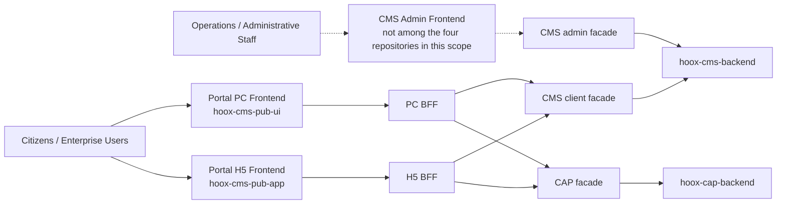
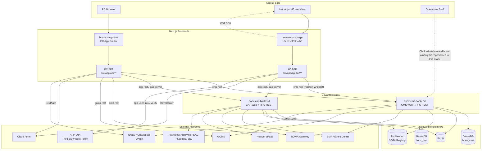
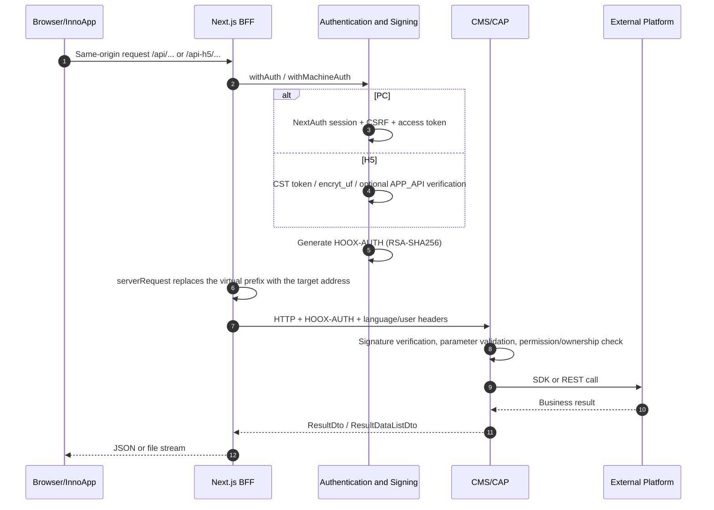
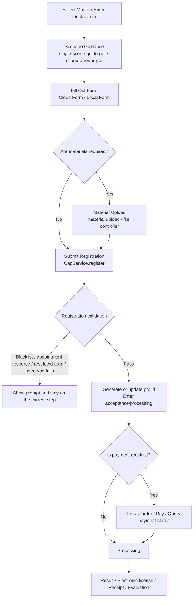
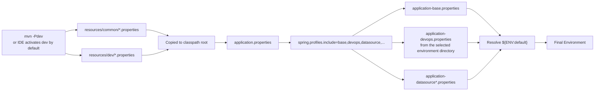

> This chapter first establishes a shared language, then explains the positioning of the four repositories, the runtime structure, the request flow, and the main declaration flow. For configuration and code standards, see 02, 03, and 04 respectively.

## 1. Terminology

| Term | Meaning in This Document | Corresponding Artifact in Code/Configuration |
| --- | --- | --- |
| Portal / webportal | An open platform for citizens/enterprises to submit declarations and process cases. In this document, Portal is equated with webportal per business usage. | The four repositories together constitute Portal's PC frontend, H5 frontend, CMS backend, and CAP backend; there is no independent module named `webportal` in the code |
| APAAS / aPaaS | The Huawei aPaaS platform, through which CAP hosts/integrates some declaration and approval capabilities. | `HUAWEI_APAAS_*`, `application-service-huawei-apaas.properties`, `HUAWEI.APAAS.OPERA.USER.CODE` |
| Roma | The Huawei ROMA gateway platform, serving as the gateway/proxy for some external APIs. | `gateway.huawei.roma.address`, `ROMA_URL`, `ROMA_HEADER_DECRYPTION_KEY`; on the CMS side there is also the OneAccess user information path |
| Event Center | The event/matter center in business usage. In code and configuration it is usually written as SMP; the class comment of `DependSmpManager` is "Matter Center", and "event center" appears in error logs. This document uniformly writes **SMP (Event Center)**. | `SMP_REST_API_BASEPATH`, `SMP_OPEN_REST_URL`, `cms.depend.smp.*`, `DependSmpManager` |
| CAP | The declaration capability backend, one of Portal's backends, providing capabilities such as matter declaration, scenario Q&A, materials, payment, licenses, and case queries. | `hoox-cap-backend`, Maven artifact `gov-hoox-cap`, API prefix commonly `/hoox/cap/...` |
| CMS | The content management/admin backend, responsible for Portal display content configuration and also providing public client APIs to PC/H5. | `hoox-cms-backend`, API prefixes commonly `/hoox/cms/admin/...` and `/hoox/cms/client/...` |
| SMP | See "Event Center". | Same as above |
| GOMS | Government operations/open APIs integrated with CMS; the current code uses it for external-link whitelist queries and verification. | `DependGomsManager`, `GOMS_OPEN_REST_URL`, `GOMS_REST_API_BASEPATH` |
| IDaaS / UAM / OneAccess | Platforms related to unified identity authentication. PC NextAuth uses OAuth; the backend configuration contains UAM application codes, callback addresses, and IDaaS role checks. | `OAUTH_APP_*`, `UAM_APP_CODE`, `UAM_APP_UNID`, `hoox.idaas.*`, `IDAAS_SERVER_URL` |
| Cloud Form / CloudForm | An external cloud form service; H5 accesses it through the `/formCenter` proxy or the form BFF. | `PROXY_CLOUD_FORM_HOST`, `NEXT_PUBLIC_PROXY_CLOUD_FORM_HOST`, `/formCenter`, `/api/form-rest`, `/api-h5/form-rest` |
| BFF | Backend for Frontend. Next.js Route Handlers; the browser accesses only them, and they perform authentication, signing, forwarding, and response shaping. | `src/app/api/**/route.ts`, `src/app/api-h5/**/route.ts`, `src/libs/request/server.ts` |
| Facade | The backend's external RPC/REST interface layer. CAP/CMS use JAX-RS annotations to define paths and use SOFA to publish services. | `*Facade.java`, `*FacadeImpl.java`, `@SofaService` |
| RPC REST Port | The REST binding port of SOFA RPC, from which ordinary JAX-RS facades are exposed. | `RPC_REST_PORT`: CAP `8346`, CMS `8343` (local dev) |
| Web Port | The Spring MVC/Tomcat port, from which file upload, download, and some Controllers are exposed. | `SERVER_PORT`: CAP `8087`, CMS `8083` (local dev) |
| `projid` | The project ID of a declaration/case, running through forms, materials, payment, and result queries. | `apasInfo.projid`, API parameter `projid` |
| `apasinfo` | The declaration information object/case information, containing fields such as matter, form answers, materials, status, and payment. | `PreApasinfoDto`, `apasInfo`, `apasinfo-*` APIs |
| `handleState` | The case processing state; H5 uses it to determine branches such as draft, correction, preview return, and completion. | `HandleState`, `apasInfo.handleState` |
| `sceneAnswer` | The answer to scenario guidance/scenario Q&A, which determines form and material requirements. | `scene-answer-get`, `single-scene-guide-get`, `insSceneAnswerUnid` |
| `HOOX-AUTH` | The API authentication header sent by the BFF to the backend: Base64(JSON payload) + `-` + RSA-SHA256 signature. | `getAuthString` / `addAuthHeader`; backend `hoox.oauth.auth.*` |
| `encryt_uf` | The Cookie in which H5 stores encrypted user information (the spelling follows the code). | `src/utils/server/apiPipe.ts`, `app-user-info/route.ts` |
| Language Table Sharding | CMS creates/accesses tables with language suffixes for each language, for example `_enus`, `_ardz`, `_frfr`. | `hoox.lang.shard=Y`, `TableCreateManager`, `TableShardUtil` |

> Terminology usage suggestion: write "Event Center (SMP)" in requirements/documents and `SMP` in code and configuration; do not invent a third naming scheme.

## 2. Positioning and Boundaries of the Four Projects

### 2.1 A Business Perspective Diagram



Key points:

- **PC/H5 are not two separate backend stacks**; they share the CMS/CAP APIs and differ only in page form, authentication method, and BFF prefix.
- **CMS serves two kinds of callers at the same time**: the admin frontend calls the `admin` facade; the Portal frontend calls the `client` facade. The repositories in this scope do not include admin frontend code.
- **CAP is one of Portal's backends, not all of Portal**. CMS, SMP, GOMS, Cloud Form, payment, aPaaS, ROMA, and others may all appear in a single business flow.
- In the current repositories, **no business configuration has been found in which CMS and CAP call each other directly**; the two are mainly composed by the frontend BFF and share external infrastructure such as SMP/UAM/Redis. `hoox-cms-pub-ui`/`hoox-cms-pub-app` appear in CAP's authentication configuration, but those are clientIds; this does not mean the CMS backend calls CAP.

### 2.2 Repository Responsibilities

| Repository | Responsible for | Not responsible for |
| --- | --- | --- |
| `hoox-cap-backend` | Main declaration flow, scenario Q&A, forms/materials, case queries, payment, licenses, files, and some no-login queries; integrates with SMP, aPaaS, ROMA, payment, archiving, etc. | Portal display content configuration; PC/H5 page rendering |
| `hoox-cms-backend` | Configuration and query of content such as columns/articles/topics/sites/dictionaries/friendly links/customer service; provides client APIs to Portal; external-link whitelist verification | Declaration business state machine; citizen case submission |
| `hoox-cms-pub-ui` | PC portal pages, PC BFF, NextAuth login, PC tracking, file preview/download | H5 native capabilities; backend business rules |
| `hoox-cms-pub-app` | H5 declaration pages, H5 BFF, InnoApp bridging, CST login state, mobile material upload/preview | PC portal; CMS admin pages |

## 3. Current State

### 3.1 Versions and Builds

| Project | Version/Technical Baseline | Build Artifact | Testing/Quality Status |
| --- | --- | --- | --- |
| `hoox-cap-backend` | Java 21; Spring Boot 2.7.18; SOFA Boot/RPC 3.14.1; `gov-hoox-cap:1.0-SNAPSHOT`; `hoox-common:1.1.2-i18n-SNAPSHOT` | Fat jar of `gov-hoox-cap-run`, classifier `executable` | JUnit 5 + Mockito unit tests; no CI configuration in the repository |
| `hoox-cms-backend` | Java 21; Spring Boot 2.7.18; SOFA 3.14.1; `hoox-cms-backend:3.9.0-SNAPSHOT` | Fat jar of `hoox-cms-run`, classifier `executable` | JUnit 5 + Mockito unit tests; no CI configuration in the repository |
| `hoox-cms-pub-ui` | Next.js 16.4.1; React 19.2.0; antd 4.24.15; NextAuth 4.24.7; Lingui 5.6.1; TS 5.3.3; Node `>=20.9.0` | `.next` + `next start`, PM2 configuration starts on port `8300` | 48 test files; build skips TS/ESLint error checks |
| `hoox-cms-pub-app` | Next.js 14.2.25; React 18.2.0; antd 5.14.2; antd-mobile 5.34.0; Lingui 4.7.0; TS 5.3.3; `basePath: '/h5'` | `.next` + `next start`, PM2 configuration starts on port `8100` | 30 test files; build skips TS/ESLint error checks |

Supplementary facts:

- The CAP root POM declares five Maven profiles, `dev/test/prod/huawei/dm`; currently only `src/main/resources/dev` exists. CMS has only the `dev` profile and the `dev` resource directory.
- Neither backend repository has a Dockerfile, Jenkinsfile, or GitLab CI file; the frontend repositories have only the PM2 `ecosystem.config.js` and no container/pipeline definitions.
- The `README.md` files of both frontends still contain the default `create-next-app` content; the H5 README says `localhost:3000`, which is inconsistent with the actual `8081` + `/h5`; use `package.json`/`next.config.js` as authoritative.

### 3.2 Module Structure

```text
hoox-cap-backend
├─ gov-hoox-cap-common      Common DTOs/utilities/constants
├─ gov-hoox-cap-online      Online declaration capabilities
│  ├─ gov-hoox-cap-online-facade   External API definitions
│  └─ gov-hoox-cap-online-server   API implementations, Controllers, Services
└─ gov-hoox-cap-run         Bootstrap module, configuration, packaging

hoox-cms-backend
├─ hoox-cms-facade          External API definitions + DTOs
├─ hoox-cms-server          Provider implementations, domain services/dao/entity, configuration, scheduled jobs
└─ hoox-cms-run             Bootstrap module, configuration, packaging
```

### 3.3 Runtime Topology



> The external dependencies in the diagram are summarized from configuration and code call relationships; "payment/archiving/EAC/logging" have independent address entries in CAP's `application-api-address.properties`; which specific business method invokes each one is subject to the corresponding Service during development.

## 4. How a Request Travels End to End

### 4.1 Common Request Flow



### 4.2 Key Differences on PC

- Login: `src/auth.ts` defines the NextAuth custom OAuth provider `cms`; `src/app/api/auth/[...nextauth]/route.ts` handles login/logout, CSRF validation, as well as language and senior-friendly parameters.
- BFF: `src/libs/request/server.ts` replaces virtual prefixes such as `/api/cms-rest`, `/api/cap-rest`, `/api/smp-rest`, `/api/goms-rest`, and `/api/form-rest` with addresses from environment variables.
- Authentication: `withAuth` in `src/utils/server/authCheck.ts` validates the session, CSRF, and access token; `addAuthHeader` uses the RSA private key to generate `HOOX-AUTH`.
- Client: `src/libs/request/client.ts` centrally handles interactions such as error codes, 429, login expiration, and draft/signature/captcha.

### 4.3 Key Differences on H5

- Login: there is no NextAuth; it relies on the InnoApp CST SDK's `cst.getToken()`, or the URL parameter `token`; the server decodes user information from the Cookie `encryt_uf`.
- BFF: `src/libs/request/server.ts` uses the `/api-h5/...` prefix; H5 has `basePath: '/h5'`, so browser addresses must be `/h5/...`.
- Authentication: when `APP_API_TOKEN_CHECK=true`, `src/utils/server/apiPipe.ts` calls `APP_API` for third-token verification; otherwise it mainly relies on the local token/cookie.
- Response: the **POST** branch of `src/app/api-h5/cap-rest/[[...proxy]]/route.ts` normalizes upstream results into `{code, flag, message, data, errorCode}`; the GET branch still passes through, consistent with PC's passthrough behavior.

## 5. Main Declaration Flow

### 5.1 Flow Overview



### 5.2 Steps and Code Locations

| Step | H5 Page/Logic | Main APIs | Description |
| --- | --- | --- | --- |
| Enter declaration | `src/app/service/Core.tsx`, `Provider.tsx` | `single-scene-guide-get`, `scene-answer-get` | Read the matter configuration, scenario questions, and material rules; `stepItems` entries are dynamically added or removed according to the configuration |
| Fill out form | `service/components/fill-form/FormFill.tsx` | Cloud Form / form APIs, `dec-basic-get`, etc. | The form may come from a Cloud Form iframe; required fields, material stages, etc. are validated before submission |
| Upload materials | `service/components/material-upload/*` | CAP file Controller, material APIs | Materials are divided into stages such as "at submission/at acceptance"; the step is skipped when there are no materials |
| Submit registration | `registerHandle` in `FormFill.tsx` | `CapService.register` → `/api-h5/cap-rest/.../apasinfo-register` | Returns `flag` and `handleState`; failures in blacklist, appointment, area, or user type will abort |
| Payment | `service/components/bill/*`, `BillModal.tsx` | `pay/create-order`, `pay-status-get`, `get-payment-form-url`, etc. | Whether payment is required is determined by the matter configuration; the payment result page is at `callback-pages/payment-result` |
| Processing/results | `service/components/result`, `service/view`, `service/receipt` | Case query, result/license/receipt APIs | `view` also handles native bridging; `handleState` drives branches such as draft, correction, and return |
| Evaluation/appeal | `service/appeal`, evaluation-related pages | Evaluation/appeal APIs | Post-case capabilities; not all matters have them |

> This table is the "main path". Actual branches are determined by the backend configuration and `handleState`; when adding a branch, do not change only the frontend `stepItems`; also check the backend state dictionary and BFF whitelist in sync.

## 6. How Configuration Is Loaded

Both backends use the same configuration mechanism: **Maven selects the environment directory, and Spring assembles configuration fragments by include**. Do not confuse Maven's `dev` with Spring's `devops`.



Key points:

1. Both `src/main/resources/common` and `src/main/resources/dev` are copied directly to the classpath root, so files with the same name in the two locations overwrite each other; the environment directory is used to override the default values in common.
2. `application.properties` is responsible only for the application name, database type, and `spring.profiles.include`; the actual addresses, accounts, and switches are mostly in `application-*.properties`.
3. `${ENV:default}` means environment variables/startup parameters are read first, and the default value is used only when they are absent. Production deployments should override through environment variables rather than modifying repository files.
4. `i18n`, `i18ns`, and `META-INF` are placed in a separate targetPath during packaging and are not loaded as Spring configuration.
5. CAP's `application.properties` also contains dynamic profiles such as `datasource-${dbType}-devops`; when `dbType=gauss`, `application-datasource-gauss-devops.properties` is loaded.

## 7. Hard Constraints and Risks in the Current State

| Item | Fact | Development Impact |
| --- | --- | --- |
| Configuration ciphertext | The backend configuration and the frontend `.env` contain ciphertext in the form `[...]`, as well as RSA private/public key configuration | Do not treat ciphertext as plaintext; when changing environments, re-encrypt with the corresponding key; do not write real keys into documents or commit records |
| Only dev resources | Both CAP and CMS have committed only the `dev` configuration directory | Do not assume that `test/prod` configurations exist; deployment parameters must be injected by the environment or a separate configuration package must be obtained |
| Frontend addresses point to the shared environment | In both frontends' `.env.development`/`.env.production`, most CMS/CAP/SMP addresses point to `10.201.50.41` | Local integration must explicitly change the base path; otherwise it will mistakenly connect to the shared environment |
| CMS schema dual configuration | JDBC defaults to `currentSchema=hoox_cms`; MyBatis-Plus global `schema=dpmp` | Confirm the actual schema when adding SQL/tables; especially verify when switching to platforms such as Dameng/Kingdee |
| CAP dual-stack Controllers | The file module contains classes annotated with both `@RestController` and JAX-RS `@Path` | When changing paths/ports, confirm whether the request goes through the Web port or the RPC REST port |
| Frontend build skips checks | Both `next.config.js` files ignore TS/ESLint build errors | CI/CD cannot rely only on build success; type checking and lint must be run separately |
| TLS verification disabled | In both frontends, `.env.development` and `.env.production` set `NODE_TLS_REJECT_UNAUTHORIZED=0` | Convenient for self-signed environments, but it disables Node-side certificate verification; production should evaluate switching to a trusted CA |
| Request security master switch off | Both frontends set `NEXT_PUBLIC_SECURITY_GLOBAL_CLOSE=true` | Security handling in the client request library is globally disabled; the server-side BFF still generates `HOOX-AUTH`, so do not mistakenly assume the backend does not verify signatures |
| H5 third-party verification switch | `APP_API_TOKEN_CHECK=false` (dev)/`true` (prod) | third-token is not verified locally but is verified in production; when troubleshooting integration login issues, check this switch first |
| H5 basePath | `next.config.js` sets `basePath: '/h5'` | All pages, BFFs, and static assets must include `/h5`; do not access them using PC's root path |
| No end-to-end tests/CI | The repositories contain only unit tests, with no E2E or pipeline definitions | Integration acceptance must manually cover the full "page → BFF → backend → external platform" chain |
| Admin frontend absent | In this scope there is only the CMS backend and no CMS admin frontend repository | When modifying the admin facade, end-to-end verification cannot be completed within this repository and requires cooperation from the admin frontend |

## 8. Suggested Reading Order

1. First use this chapter to establish terminology and request-flow concepts.
2. If you need to get it running: read [02-Integration and Configuration Standards](/2026/10/28/portal-integration-and-configuration-standards).
3. To modify the backend: read [03-Backend Development Standards](/2026/10/28/portal-backend-development-standards), then see [05-Directory Guide](/2026/10/28/portal-directory-guide).
4. To modify the frontend: read [04-Frontend Development Standards](/2026/10/28/portal-frontend-development-standards), focusing on the BFF whitelist and authentication sections.
5. If you are unsure where code belongs: directly consult "Where to Change What" in 05.
