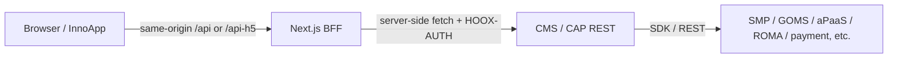
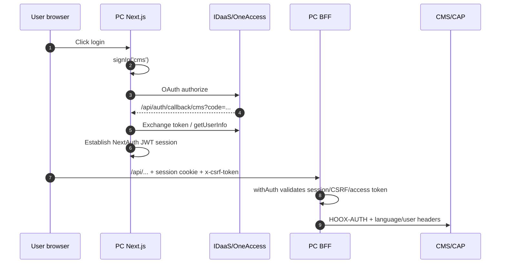
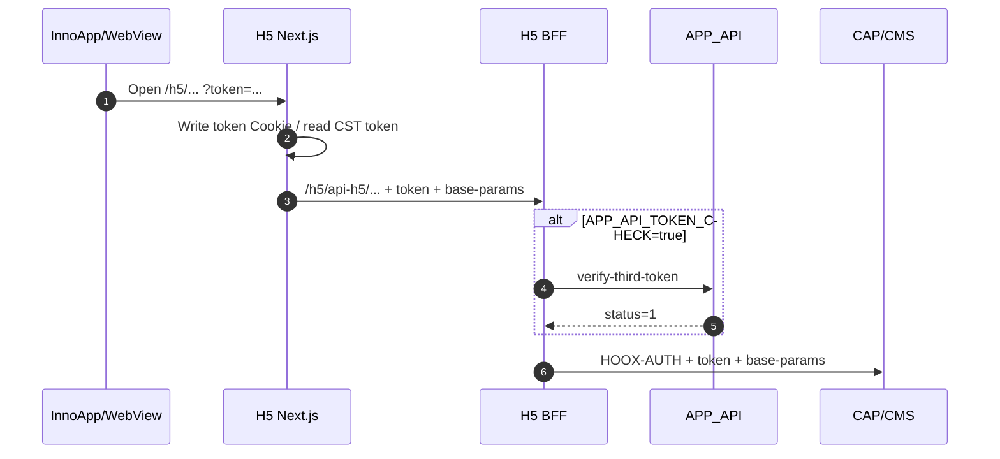

> This chapter answers only two things: **how frontend and backend integrate** and **where configuration is changed**. Key values are always represented by placeholders/"ciphertext"; shared environment addresses already committed to the repository are listed at their original values, to identify "accidental connections to the shared environment" — do not treat them as local machine addresses.
>
> Local ports follow the repository's `dev` configuration; shared environment/production follows deployment parameters.

## 1. Understand the Integration Model First

### 1.1 Browsers Do Not Connect Directly to the Java Backend



The reasons for this design (which are also code facts):

- The BFF converts the NextAuth/CST login state into the `HOOX-AUTH`, `token`, and `base-params` recognized by the backend.
- Backend addresses and the RSA private key are placed only in Node server-side environment variables and are not exposed to the browser.
- The browser only faces same-origin addresses, so the backend does not need to enable CORS.
- The BFF can uniformly handle CSRF, CAPTCHA, response normalization, and file stream processing.

**Do not** let the browser request `8343/8346` directly "to make things faster": this bypasses the BFF's authentication, whitelist, IP/language headers, and error handling at the same time, and also requires additional CORS handling.

### 1.2 Do Not Mix the Three Types of Addresses

| Type | Example | Who can see it | Notes |
| --- | --- | --- | --- |
| Browser access address | `NEXTAUTH_URL`, `NEXT_PUBLIC_H5_SERVICE_ADDRESS`, `NEXT_PUBLIC_APP_SERVICE_ADDRESS` | Browser/external | Must be an address accessible from the user's browser; do not use the container's internal IP |
| BFF-to-backend address | `CMS_REST_API_BASEPATH`, `CAP_REST_API_BASEPATH`, `CAP_SERVER_API_BASEPATH` | Node server only | For local integration, use `127.0.0.1:<local port>`; for the shared environment, use the actual service address |
| Backend-to-dependency address | `SMP_OPEN_REST_URL`, `GOMS_OPEN_REST_URL`, `HUAWEI_APAAS_DOMAIN_ADDRESS`, `ROMA_URL` | Java backend only | Determined by the network environment where the backend resides, not by frontend variables |

### 1.3 Virtual Prefix Mapping

Both frontends perform prefix replacement in `src/libs/request/server.ts`. **A request must first hit a Next route, and then `serverRequest` replaces the prefix.**

#### PC (`hoox-cms-pub-ui`)

| Virtual prefix | Target environment variable | Notes |
| --- | --- | --- |
| `/api/cms-rest` | `CMS_REST_API_BASEPATH` | CMS client REST, usually the CMS RPC REST port |
| `/api/cms-server` | `CMS_SERVER_API_BASEPATH` | CMS Web port (files/some MVC endpoints) |
| `/api/message-rest` | `CMS_SERVER_API_BASEPATH` | Message-related; also lands on the CMS Web port |
| `/api/smp-rest` | `SMP_REST_API_BASEPATH` | Direct connection to SMP/Event Center |
| `/api/cap-rest` | `CAP_REST_API_BASEPATH` | CAP RPC REST port |
| `/api/cap-server` | `CAP_SERVER_API_BASEPATH` | CAP Web port; **there is no corresponding physical Next route**; called only internally by the server |
| `/api/goms-rest` | `GOMS_REST_API_BASEPATH` | GOMS open APIs |
| `/api/form-rest` | `PROXY_CLOUD_FORM_HOST` | Cloud Form; note that the UI uses the variable without `NEXT_PUBLIC_` |

#### H5 (`hoox-cms-pub-app`)

| Virtual prefix | Target environment variable | Notes |
| --- | --- | --- |
| `/api-h5/cms-rest` | `CMS_REST_API_BASEPATH` | CMS client REST |
| `/api-h5/cms-server` | `CMS_SERVER_API_BASEPATH` | CMS Web |
| `/api-h5/smp-rest` | `SMP_REST_API_BASEPATH` | SMP |
| `/api-h5/cap-rest` | `CAP_REST_API_BASEPATH` | CAP RPC REST |
| `/h5/api-h5/cap-server` | `CAP_SERVER_API_BASEPATH` | Note that the prefix includes `/h5` |
| `/api-h5/goms-rest` | `GOMS_REST_API_BASEPATH` | GOMS |
| `/api-h5/form-rest` | `NEXT_PUBLIC_PROXY_CLOUD_FORM_HOST` | Cloud Form; H5 uses the variable with `NEXT_PUBLIC_` |

Two details:

1. `serverRequest` only performs string replacement; **it does not automatically add slashes and does not modify the query**. The base path must not end with `/`, and business paths must start with `/`.
2. PC's `/api/cap-server`, `/api/cms-server`, and `/api/message-rest` are "logical prefixes"; the browser should not access them directly. The actual file upload entry is usually a dedicated route such as `src/app/api/(common)/cap-file-upload/route.ts`. The same applies to H5's `/h5/api-h5/cap-server`; there is no physical route with the same name.
3. The existence of a prefix mapping does not mean there is necessarily a corresponding physical BFF route. For example, H5's `serverRequest` supports `/api-h5/goms-rest`, but there is currently no `goms-rest` directory under `src/app/api-h5`; confirm that a route exists before adding a call.

## 2. Local Startup

### 2.1 Prerequisites

| Item | Requirement | Basis |
| --- | --- | --- |
| JDK | 21 | `maven.compiler.release=21` in both backend POMs |
| Maven | Can access the intranet Nexus and resolve the `hoox-common` BOM and SOFA dependencies | The POM depends on internal `com.linewell.gov.hoox` components |
| Node.js | PC `>=20.9.0`; H5 is recommended to use the same version | `engines` in `hoox-cms-pub-ui/package.json`; the UI also has `engine-strict=true` |
| npm | Use npm; PC's `preinstall` enforces `only-allow npm` | `.npmrc`, `package.json` |
| Database | GaussDB/PostgreSQL, CAP schema `hoox_cap`, CMS schema `hoox_cms` | Both `dev/application-datasource-gauss-devops.properties` |
| Middleware | Redis, ZooKeeper (SOFA registry center) | `REDIS_*`, `SOFA_RPC_REGISTRY_ADDRESS` |
| External platforms | SMP, UAM/IDaaS, GOMS, etc. reachable as needed | `dev/application-devops.properties` |

> Internal npm private registry addresses are written in the `.npmrc` of the two repositories: `@linewell:registry=...`. If `npm install` reports 404, first confirm the private registry and network; do not suspect the code first.

### 2.2 Backend Startup

#### CAP

```powershell
cd D:\project\portal\hoox-cap-backend

# Method 1: Run directly in the IDE
#   gov-hoox-cap-run/src/main/java/com/linewell/gov/hoox/cap/run/CapWebApplication.java
#
# Method 2: Run after packaging (-Pdev selects resources/dev)
mvn -pl gov-hoox-cap-run -am clean package -Pdev -DskipTests
java -jar gov-hoox-cap-run\target\gov-hoox-cap-run-1.0-SNAPSHOT-executable.jar
```

After startup:

- Web/MVC: `http://127.0.0.1:8087`
- SOFA RPC REST: `http://127.0.0.1:8346`
- Bolt: `22006`

#### CMS

```powershell
cd D:\project\portal\hoox-cms-backend

# Method 1: Run directly in the IDE
#   hoox-cms-run/src/main/java/com/linewell/gov/hoox/cms/run/CmsWebApplication.java
#
# Method 2: Run after packaging
mvn -pl hoox-cms-run -am clean package -Pdev -DskipTests
java -jar hoox-cms-run\target\hoox-cms-run-3.9.0-SNAPSHOT-executable.jar
```

After startup:

- Web/MVC: `http://127.0.0.1:8083`
- SOFA RPC REST: `http://127.0.0.1:8343`
- Bolt: `22123`

> **Maven profile vs. Spring profile**: `-Pdev` is a Maven resource selection switch; on the Spring side, what is actually activated are fragments such as `devops` and `datasource` in `spring.profiles.include`. Do not write `--spring.profiles.active=dev` and then expect it to load `resources/dev`; that is not how this project works.
>
> If the IDE reports "configuration not found" at runtime, first check whether the `dev` profile is activated in the Maven panel and whether `application-devops.properties` exists under `target/classes`.

### 2.3 Frontend Startup

```powershell
cd D:\project\portal\hoox-cms-pub-ui
npm install
npm run dev
# http://localhost:8080

cd D:\project\portal\hoox-cms-pub-app
npm install
npm run dev
# http://localhost:8081/h5
```

Both `dev` scripts first run `lingui:compile`; therefore `src/locales/**` must be in a compilable state. If the copy was just changed, run `npm run lingui:extract` first.

### 2.4 Frontend Production Startup (Local Acceptance)

```powershell
# PC
npm run build
npm run start        # next start -p 8000

# H5
npm run build
npm run start        # next start -p 8100
```

PM2 configuration is specified separately:

- PC `ecosystem.config.js`: `next start -p 8300`
- H5 `ecosystem.config.js`: `next start -p 8100`

> `npm run build` executes `lingui:extract --clean` and `lingui:compile`, and both frontends run `npm install` once more during build. The build machine must be able to access the private registry, and after building you must check whether the locale files have unexpected changes.

## 3. Port and Address Matrix

### 3.1 Service Ports

| Service | Local dev | Notes |
| --- | --- | --- |
| CAP Web | `8087` | `SERVER_PORT`; Spring MVC/file Controller |
| CAP RPC REST | `8346` | `RPC_REST_PORT`; ordinary JAX-RS facade |
| CAP Bolt | `22006` | `RPC_BOLT_PORT`; SOFA Bolt |
| CMS Web | `8083` | `SERVER_PORT` |
| CMS RPC REST | `8343` | `RPC_REST_PORT` |
| CMS Bolt | `22123` | `RPC_BOLT_PORT` |
| PC dev | `8080` | `next dev -p 8080` |
| PC `next start` | `8000` | `npm run start` |
| PC PM2 | `8300` | `ecosystem.config.js` |
| H5 dev | `8081` | `next dev -p 8081`, access with `/h5` |
| H5 `next start` | `8100` | `npm run start` |
| H5 PM2 | `8100` | `ecosystem.config.js` |

### 3.2 There Is a "Mismatch" in CAP's Own Address Variables

In `common/application-service-cap.properties`:

```properties
cap.rest.address=${CAP_REST_ADDRESS:http://127.0.0.1:8341}
cap.web.address=${CAP_WEB_ADDRESS:http://127.0.0.1:8080}
```

However, the actual local dev listeners are REST `8346` and Web `8087`. This indicates that these two variables are **used by business code to assemble external/callback addresses**, and are not necessarily equal to the actual SOFA bind ports. During integration:

- The frontend accesses CAP with `CAP_REST_API_BASEPATH=http://127.0.0.1:8346` and `CAP_SERVER_API_BASEPATH=http://127.0.0.1:8087`.
- If a business-returned link/callback still points to `8341/8080`, override it through the environment variables `CAP_REST_ADDRESS` and `CAP_WEB_ADDRESS`; do not modify the POM.

### 3.3 Frontend Addresses Registered in the Repository

In the two frontends' `.env.development` and `.env.production`, the following values are basically identical (all are shared environment addresses):

| Variable | Value registered in the repository |
| --- | --- |
| `CMS_REST_API_BASEPATH` | `http://10.201.50.41:8345` |
| `CMS_SERVER_API_BASEPATH` | `http://10.201.50.41:8083` |
| `SMP_REST_API_BASEPATH` | `http://10.201.50.41:8344` |
| `CAP_REST_API_BASEPATH` | `http://10.201.50.41:8342` |
| `CAP_SERVER_API_BASEPATH` | `http://10.201.50.41:8081` |
| `GOMS_REST_API_BASEPATH` | `http://10.201.50.41:8343` |

**These values do not correspond one-to-one to the local backend ports**:

- The frontend CMS REST specifies `8345`, while local CMS RPC REST is `8343`.
- The frontend CAP REST specifies `8342`, while local CAP RPC REST is `8346`.
- The frontend CAP Web specifies `8081`, while local CAP Web is `8087`.

Therefore, local integration must explicitly override them; do not "see that 8083 matches and assume CMS is fully connected". CMS Web's `8083` happens to be the same, but REST is different.

### 3.4 Browser Access Addresses

| Variable | dev | production |
| --- | --- | --- |
| PC `NEXTAUTH_URL` | `http://localhost:8080` | `http://192.168.203.33:3006` |
| PC `NEXT_PUBLIC_H5_SERVICE_ADDRESS` | `http://localhost:8081` | `http://192.168.203.33:3006` |
| H5 `NEXT_PUBLIC_WEB_SERVICE_ADDRESS` | `http://localhost:8080` | `http://192.168.203.33:3006` |
| H5 `NEXT_PUBLIC_APP_H5_URL` | `http://manage-yf.linewell.com:6443/algeria` | Same as left |
| For both, `APP_API` (H5) | `http://manage-yf.linewell.com:6443` | Same as left |

`NEXTAUTH_URL` must be consistent with the address through which the browser actually accesses PC; otherwise the OAuth callback will be assembled incorrectly, and the typical error is a `redirect_uri` mismatch.

## 4. Frontend Configuration File Standards

### 4.1 File Responsibilities

| File | When loaded | Committed | Purpose |
| --- | --- | --- | --- |
| `.env.development` | `next dev` | Yes | Local/development defaults |
| `.env.production` | `next build` / `next start` (production mode) | Yes | Production/shared environment defaults |
| `.env.local` | Corresponding mode, with higher priority | **No** | Personal local overrides; currently absent from the repository |
| `next.config.js` | Build/startup | Yes | `basePath`, compilation switches, images, externals; not the place for business addresses |
| `ecosystem.config.js` | PM2 startup | Yes | Process name, port, instance count, environment variable passthrough |

Priority and override rules follow Next.js; the team convention is: **shared defaults go into `.env.development/.env.production`, personal differences go into `.env.local`, and secrets do not go into Git**.

### 4.2 Key Variable Groups

#### Backend Addresses (Used Server-Side, Without `NEXT_PUBLIC_`)

| Variable | PC | H5 | Meaning |
| --- | --- | --- | --- |
| `CMS_REST_API_BASEPATH` | Required | Required | CMS client REST |
| `CMS_SERVER_API_BASEPATH` | Required | Configured* | CMS Web/files |
| `SMP_REST_API_BASEPATH` | Required | Configured* | SMP |
| `CAP_REST_API_BASEPATH` | Required | Required | CAP REST |
| `CAP_SERVER_API_BASEPATH` | Required | Configured* | CAP Web/files (logical prefix) |
| `GOMS_REST_API_BASEPATH` | Required | Configured* | GOMS |
| `PROXY_CLOUD_FORM_HOST` | Required | — | PC Cloud Form proxy |
| `NEXT_PUBLIC_PROXY_CLOUD_FORM_HOST` | — | Required | H5 Cloud Form proxy |
| `APP_API` | — | Required | H5 third-party user/token service |

> `*` means that H5's `.env` and `serverRequest` have this prefix, but there is currently no corresponding generic BFF route under `src/app/api-h5`; you cannot assume an API is callable merely because the variable exists. H5's `cms-server`, `smp-rest`, `goms-rest`, and `cap-server` all fall into this case.
>
> The reason these variables do not have the `NEXT_PUBLIC_` prefix is that they are used only in Route Handlers/Server Components. Adding the prefix would put them into the client bundle and leak internal addresses.

#### Authentication and Login

| Variable | PC | H5 | Notes |
| --- | --- | --- | --- |
| `CLIENT_ID` | `hoox-cms-pub-ui` | `hoox-cms-pub-app` | Must align with the backend's `hooxAppAuthProvider.<clientId>` |
| `CMS_API_AUTH_K` | Required | Required | CMS API RSA private key (ciphertext) |
| `CAP_API_AUTH_K` | Required | Required | CAP API RSA private key (ciphertext) |
| `SMP_API_AUTH_K` | Required | **Currently absent** | Private key for PC to access SMP; if H5 adds signed calls, it must be added |
| `GOMS_API_AUTH_K` | Required | **Currently absent** | Private key for PC to access GOMS |
| `FORM_API_AUTH_K` | Required | Required | Cloud Form API private key |
| `FORM_REST_API_AK` | Required | Required | Cloud Form `app_key` (ciphertext) |
| `NEXTAUTH_SECRET` | Required | — | NextAuth JWT encryption |
| `NEXTAUTH_URL` | Required | — | OAuth callback base address |
| `OAUTH_APP_BASEPATH` / `OAUTH_APP_ID` | Required | Required | OAuth service address/application ID |
| `OAUTH_APP_S` | Required | — | PC OAuth secret |
| `OAUTH_APP_SECRET` | — | Required | H5 OAuth secret (name differs from PC) |
| `OAUTH_APP_ROMA_*` | Optional | Optional | Used when going through ROMA/OneAccess user information |
| `APP_API_TOKEN_CHECK` | — | Needs attention | Validates third-token when `true` |

In code, `*_API_AUTH_K` is first passed through `configDecrypt` and then assembled into a PEM private key; it is not "just any signing salt". When changing environments, the private key, backend public key, and `CLIENT_ID` must be changed together.

#### Runtime Switches

| Variable | Current state | Notes |
| --- | --- | --- |
| `NEXT_PUBLIC_SECURITY_GLOBAL_CLOSE` | `true` for both frontends | Master switch for security handling in the client request library; does not mean the backend does not verify signatures |
| `NODE_TLS_REJECT_UNAUTHORIZED` | `0` for both frontends in dev/prod | Disables Node TLS certificate verification; usable in self-signed environments, but production should be evaluated |
| `NEXT_PUBLIC_HWBP_OPEN` | Per environment | Whether to load the tracking SDK |
| `NEXT_PUBLIC_OAUTH_ACCESS_TOKEN_VERIFY_INTERVAL_MS` | Configured for PC | Access token verification time window; `0` means verify every time, `<0` means skip |
| `HOOX_AUTH_EXPIRE_TIME` | Configured for PC | Authentication header validity period (milliseconds) |
| `NEXT_PUBLIC_KEEP_LOGIN` / password/browser version variables | Per environment | Login page and frontend validation policies |

#### `NEXT_PUBLIC_` Rules

- `NEXT_PUBLIC_*` is inlined into the browser bundle at build time; if changed, it must be rebuilt.
- Do not add `NEXT_PUBLIC_` to actual server-side secrets. The current repository contains some historical variables with this prefix (such as `NEXT_PUBLIC_SIGNATURE_PRIVATE_KEY` and `NEXT_PUBLIC_API_FORM_ENCRYPTION_AES_KEY`); do not blindly imitate them when adding variables, first confirm whether it should originally be exposed to the browser.
- Only browser-visible addresses (H5/APP redirects, OAuth callbacks) should use `NEXT_PUBLIC_` or `NEXTAUTH_URL`.

### 4.3 Mandatory Differences Between PC and H5

| Item | PC | H5 |
| --- | --- | --- |
| BFF prefix | `/api/...` | `/api-h5/...` |
| Route basePath | None | `/h5` |
| Login | NextAuth + OAuth | CST SDK / `token` / `encryt_uf` |
| OAuth secret variable | `OAUTH_APP_S` | `OAUTH_APP_SECRET` |
| Cloud Form variable | `PROXY_CLOUD_FORM_HOST` | `NEXT_PUBLIC_PROXY_CLOUD_FORM_HOST` |
| Third-party token validation | No such switch | `APP_API_TOKEN_CHECK` |
| Mobile redirect | `middleware.ts` redirects to H5 by UA | None |
| Component library | antd 4 | antd 5 + antd-mobile 5 |

## 5. Backend Configuration File Standards

### 5.1 Key CAP Files

| File | Role | Commonly changed during integration |
| --- | --- | --- |
| `gov-hoox-cap-run/src/main/resources/common/application.properties` | Application name, `dbType`, `spring.profiles.include` | Usually unchanged |
| `common/application-base.properties` | Basic items such as ports, i18n, encryption, and sessions | Change when ports/keys are involved |
| `common/application-service-cap.properties` | `cap.rest.address`, `cap.web.address`, upload limits, feature switches | Change when callback addresses are wrong |
| `common/application-service-oauth.properties` | `hoox.oauth.auth.*`, public keys for each clientId, authentication URL scope | Must check when switching frontend/keys |
| `common/application-api-address.properties` | External addresses for archiving, SMP, EAC, payment, logging, etc. | Change when switching external environments |
| `common/application-plugins-gateway.properties` | Huawei gateway switch, ROMA address/type | Change when going through ROMA |
| `common/application-service-huawei-apaas.properties` | aPaaS client/domain/user | Change when integrating with aPaaS |
| `common/application-data-redis.properties` | Redis connection | Change for local Redis |
| `common/application-datasource.properties` | Druid data source defaults | Usually overridden by environment variables |
| `common/application-datasource-mybatis.properties` | Mapper paths, field encryption key | Check when adding a Mapper/changing the key |
| `dev/application-devops.properties` | Ports for this environment, SMP/EAC/payment/logging, ZK, Redis, UAM | **Main file for local integration changes** |
| `dev/application-other-devops.properties` | ROMA, aPaaS, gateway switch | Change when integrating with the Huawei environment |
| `dev/application-datasource-gauss-devops.properties` | GaussDB address, schema, account | **Main file for local database changes** |

The most frequently changed CAP keys locally:

```properties
SERVER_PORT=8087
RPC_REST_PORT=8346
RPC_BOLT_PORT=22006

DATABASE_IP=127.0.0.1
DATABASE_PORT=8000
SPRING_DATASOURCE_CAP_DRUID_URL=jdbc:postgresql://${DATABASE_IP}:${DATABASE_PORT}/db_nw?currentSchema=hoox_cap

SOFA_RPC_REGISTRY_ADDRESS=zookeeper://127.0.0.1:2181
REDIS_HOST=127.0.0.1
REDIS_PORT=6379
REDIS_DATABASE=4

SMP_OPEN_REST_URL=http://<smp-host>:<smp-port>
CAP_REST_ADDRESS=http://127.0.0.1:8346
CAP_WEB_ADDRESS=http://127.0.0.1:8087
```

> The above is an illustration of "change to local machine/change to a reachable environment" and does not represent the repository's existing values. External platforms such as SMP and payment usually do not have local instances, so enter the actually reachable addresses; passwords/keys must use the ciphertext for the current environment and must not be written in plaintext.

### 5.2 Key CMS Files

| File | Role | Commonly changed during integration |
| --- | --- | --- |
| `hoox-cms-run/src/main/resources/common/application.properties` | Application name, `dbType`, include list | Usually unchanged |
| `common/application-base.properties` | Ports, i18n, encryption, sessions | Check when changing ports/language table sharding |
| `common/application-data-mybatis.properties` | Mapper paths, MyBatis-Plus `schema`, field encryption | Check when adding a Mapper/schema |
| `common/application-data-redis.properties` | Redis namespace/connection | Change for local Redis |
| `common/application-data-oauth.properties` | Authentication switch, clientId public key, authentication URL | Must check when switching frontend/keys |
| `common/application-data-depend.properties` | SMP/GOMS dependency API paths | Change when external APIs change |
| `common/application-data-idaas.properties` | IDaaS role/permission checks | Check on 403 after login |
| `common/application-datasource.properties` | Data source defaults | Usually overridden by environment variables |
| `dev/application-devops.properties` | Ports, SMP/GOMS, UAM, ZK, Redis, KMS | **Main file for local integration changes** |
| `dev/application-datasource-gauss-devops.properties` | GaussDB address, schema, account | **Main file for local database changes** |

The most frequently changed CMS keys locally:

```properties
SERVER_PORT=8083
RPC_REST_PORT=8343
RPC_BOLT_PORT=22123

SPRING_DATASOURCE_CMS_DRUID_URL=jdbc:postgresql://127.0.0.1:8000/db_nw?currentSchema=hoox_cms
SOFA_RPC_REGISTRY_ADDRESS=zookeeper://127.0.0.1:2181
REDIS_HOST=127.0.0.1
REDIS_PORT=6379
REDIS_DATABASE=0

SMP_OPEN_REST_URL=http://<smp-host>:<smp-port>
GOMS_OPEN_REST_URL=http://<goms-host>:<goms-port>
PORTAL_DOMAIN_ADDRESS=http://localhost:8080
```

CMS has another point that must be checked at the same time:

```properties
# JDBC URL
currentSchema=hoox_cms

# MyBatis-Plus global schema
mybatis-plus.global-config.db-config.schema=dpmp
```

The two default values are inconsistent. When adding handwritten SQL / Mapper, if the table name does not include a schema, which schema the query actually lands on depends on the connection and framework configuration; confirm this during integration, and do not wait until production to discover that the wrong database was queried.

### 5.3 Configuration Layering Standards

| Layer | What to put | What not to put |
| --- | --- | --- |
| `common` | Default values consistent across all environments, feature switch defaults, API path templates | IPs of a specific machine, accounts/passwords of a specific environment |
| `dev`/`test`/`prod` | Addresses, ports, accounts, certificate paths unique to that environment | Business constants unrelated to the environment |
| Environment variables/startup parameters | Passwords, IPs, switches injected at deployment time | Default values that need version control |
| Database/configuration center | Business configuration that can change at runtime | Ports/data sources required for startup |

Conventions:

1. New configuration items must have a default value or explicit required validation; do not leave implicit dependencies that "only production configures".
2. Address-type configuration must uniformly use a complete URL (including scheme, port, and context path); do not manually concatenate `http://` in code.
3. Passwords, private keys, and AK/SK must use the `[ciphertext]` form, and the decryption key for the current environment must be confirmed; plaintext commits are prohibited.
4. Keep only one key for the same meaning. CAP already has `CAP_REST_ADDRESS`/`CAP_WEB_ADDRESS`; do not create another `cap.url`.
5. When changing a port, check all of the following at the same time: this file, frontend base path, Nginx/gateway, OAuth callback, and SOFA registry address.
6. When adding a fragment to `spring.profiles.include`, ensure that the corresponding `application-<name>.properties` exists on the classpath; otherwise startup will not report a "missing file", but the related configuration will be silently missing.

## 6. Authentication Integration

### 6.1 Generation and Verification of `HOOX-AUTH`

The `rsaEncrypt` logic is identical in both frontends:

1. Assemble the payload: `clientId` + user fields (when a login state exists) + `extend.time`, etc.
2. Convert to Base64 after `JSON.stringify`.
3. Use the RSA private key decrypted from `*_API_AUTH_K` to sign the Base64 string with `RSA-SHA256`.
4. Assemble `Base64(payload)-Base64(signature)` and put it into `HOOX-AUTH`.
5. The backend finds the `hoox.oauth.auth.hooxAppAuthProvider.<clientId>.publicKey` based on the `clientId` in the payload to verify the signature, and checks the validity period/URL scope.

The four items that must match in pairs:

| Frontend | Backend |
| --- | --- |
| `CLIENT_ID` | `hoox.oauth.auth.hooxAppAuthProvider.<clientId>` |
| `CMS_API_AUTH_K` / `CAP_API_AUTH_K` / ... | The corresponding provider's `publicKey` |
| Actual request path | `authIncludeUrl` / `authExcludeUrl` regex |
| `HOOX_AUTH_EXPIRE_TIME` | Backend authentication validity period/clock |

Backend signature verification switch:

```properties
hoox.oauth.auth.enable=${HOOX_OAUTH_AUTH_ENABLE:true}
```

Local temporary disable (local machine only, troubleshooting only):

```powershell
$env:HOOX_OAUTH_AUTH_ENABLE="false"
```

After disabling, the BFF still sends `HOOX-AUTH`; the backend simply does not verify it. **Do not** commit the disabled state to the `dev` configuration, let alone carry it into test/prod.

### 6.2 PC Login and CSRF



Integration points:

- `NEXTAUTH_URL` must be consistent with the browser address; `http://localhost:8080/api/auth/callback/cms` must be registered in the OAuth application.
- The CSRF Cookie name is `__Host-next-auth.csrf-token` under HTTPS and `next-auth.csrf-token` under HTTP; `withAuth` compares the Cookie with the `x-csrf-token` header (POST must include it).
- `getSignature` skips only CSRF, not session/access token; `single-scene-guide-get` skips the entire authentication block in the CAP proxy.
- The `one-access-token` header can bypass session/CSRF but still verifies the access token; this is for specific integration scenarios and should not be treated as a normal login method.
- Logout first clears the Cloud Form cache and revokes the access token, and only then verifies CSRF; do not break this order when changing the logout logic.

### 6.3 H5 Login and Token



Integration points:

- `APP_API_TOKEN_CHECK`: default `false` in dev and `true` in prod. When local login fails, confirm this first; do not start by changing the backend.
- `encryt_uf` is a server-side encrypted user information Cookie written by the `app-user-info` route; do not forge it manually, and check its decryption result when troubleshooting.
- `base-params` includes at least `appId` and `lang`; the H5 request library automatically supplements defaults such as `{"appId": A_ID, "lang": "en_US"}`.
- H5's `rsaEncryptSign` only handles the three prefixes `/api-h5/cap-`, `/api-h5/form-`, and `/api-h5/cms-`; when adding SMP/GOMS signed calls, the branch must be extended accordingly, otherwise `HOOX-AUTH` may not be obtained.
- H5 has no NextAuth and no CSRF double submit; do not copy PC's login troubleshooting steps.

## 7. Integration Scenarios

### Scenario A: Change Only the Frontend and Connect to the Shared Environment

Applicable: page/style/interaction development, with the backend on the shared environment.

1. Keep the `10.201.50.41` addresses in `.env.development` unchanged.
2. `npm install && npm run dev`.
3. PC login requires a shared environment IDaaS account; H5 requires an InnoApp container or a valid `token`.
4. Do not modify `CLIENT_ID`/`*_API_AUTH_K`, otherwise the shared environment backend will not recognize them.

### Scenario B: PC + Local CMS

Applicable: changing CMS client APIs and PC content display.

1. Start CMS (`8083/8343`) and ensure DB/Redis/ZK are reachable.
2. Modify `hoox-cms-pub-ui/.env.development`:

```dotenv
CMS_REST_API_BASEPATH=http://127.0.0.1:8343
CMS_SERVER_API_BASEPATH=http://127.0.0.1:8083
NEXTAUTH_URL=http://localhost:8080
```

3. CAP/SMP/GOMS can continue pointing to the shared environment; if the page only uses CMS, there is no impact.
4. Confirm on the IDaaS side that `http://localhost:8080/api/auth/callback/cms` is registered.
5. Start PC, and confirm in the browser Network panel that `/api/cms-rest/...` returns 200 and that the CMS logs contain the corresponding request.

### Scenario C: H5 + Local CAP

Applicable: changing the declaration flow, materials, payment, and H5 BFF.

1. Start CAP (`8087/8346`).
2. Modify `hoox-cms-pub-app/.env.development`:

```dotenv
CAP_REST_API_BASEPATH=http://127.0.0.1:8346
CAP_SERVER_API_BASEPATH=http://127.0.0.1:8087
CMS_REST_API_BASEPATH=http://127.0.0.1:8343
APP_API_TOKEN_CHECK=false
```

3. If `APP_API` is unreachable, `APP_API_TOKEN_CHECK=false` in dev can bypass validation first; however, `app-user-info` may still need `APP_API`, so login state issues must be examined separately.
4. Change the Cloud Form address to a reachable environment; otherwise the form-filling step will show a blank screen/time out.
5. Open `http://localhost:8081/h5/...` using InnoApp or a URL with `?token=`.

### Scenario D: All Four Projects Local

1. Start CMS and CAP first, then start PC and H5.
2. Point the two frontends to the local backend respectively; H5's `CMS_REST_API_BASEPATH` must also point to the local CMS (if H5 pages use CMS content).
3. Change CMS's `PORTAL_DOMAIN_ADDRESS` to `http://localhost:8080` to prevent backend-generated links from jumping back to the shared environment.
4. If CAP returns file/payment callback addresses, set `CAP_REST_ADDRESS` and `CAP_WEB_ADDRESS` as needed.
5. IDaaS/APP_API/Cloud Form generally cannot be localized and still need to connect to the shared environment; this is "semi-local" integration, not fully offline.

### Scenario E: Verify Backend APIs Only

Prefer Swagger or unit tests; do not manually assemble `HOOX-AUTH`. If a direct connection is necessary:

- Temporarily set `HOOX_OAUTH_AUTH_ENABLE=false` (local machine only).
- Use `Test-NetConnection 127.0.0.1 -Port 8343` to confirm the port.
- When connecting directly, supply headers such as `Content-Language`, `token`, and `base-params` yourself; this cannot replace BFF integration.

## 8. Complete Steps for Adding a Frontend-Backend API

Take "adding a CAP query API on PC" as an example:

1. **Backend**: define the JAX-RS method in `*-facade`, implement it in `*FacadeImpl`, and confirm the complete path (including `/hoox/cap/...`) and HTTP method.
2. **BFF data source**: add a method under `src/core/datasources/{client,server}/...`; the path must start with `/api/cap-rest/...`.
3. **BFF whitelist**: add the **exact path** (without query) to `WHITELIST_GET_PATHS` or `WHITELIST_POST_PATHS` in `src/app/api/cap-rest/[[...proxy]]/route.ts`.
4. **Authentication**: confirm whether a `withAuth` exclusion is needed; by default, do not exclude. When CSRF must be skipped, add only `csrfExcludes`; do not also skip session in passing.
5. **Response**: consume according to `BaseResponse`; for file streams/encrypted responses, refer to the existing `hoox-data-secret` branch and do not use `Response.json` directly.
6. **H5 (if needed)**: repeat steps 2-4, but change the prefix to `/api-h5/...`, and check whether H5's `rsaEncryptSign` covers that prefix.
7. **Tests**: add datasource/route unit tests; cover at least whitelist hit, miss 404, authentication failure, and normal response.

### BFF Route Template

When a dynamic proxy (`[[...proxy]]`) already exists, usually only the whitelist needs to be added; when there is no dynamic proxy, create:

```ts
// src/app/api/xxx/route.ts
import type { NextRequest } from 'next/server';

import { serverRequest } from '@/libs/request/server';
import { addAuthHeader, withAuth } from '@/utils/server/authCheck';

export const GET = withAuth(
  addAuthHeader(async (request: NextRequest) => {
    const data = await serverRequest('/api/cms-rest/hoox/cms/client/...', {
      method: 'GET',
      headers: request.headers,
      request,
    });
    return Response.json(data);
  }),
);
```

Notes:

- The `request` option of `serverRequest` is used to pass through the client IP; not all routes must pass it, but it should be passed when risk control/auditing is involved.
- Return a `Response` rather than a plain object; file streams must retain `Content-Type`/`Content-Disposition`.
- Dynamic proxy path matching uses **exact strings**, and the query is removed by `split('?')[0]`; do not include a query in new paths.
- Use kebab-case for route directory names; use `-` for business segments, such as `cap-rest` and `cms-server`; do not use underscores or camelCase.

## 9. Common Troubleshooting

| Symptom | Check first | Action |
| --- | --- | --- |
| BFF returns 404 `Not Found` | Request method, virtual prefix, exact whitelist path | Add the path to `WHITELIST_*` in the corresponding `route.ts`; confirm GET/POST is not reversed |
| BFF returns `ESYS120001` | NextAuth session, CSRF, access token, `encryt_uf` | Log in to PC again; check `x-csrf-token`; for H5 check `APP_API_TOKEN_CHECK` and the token |
| Backend returns signature verification failure/401 | `CLIENT_ID`, private/public key, request path, clock | Confirm that the frontend `*_API_AUTH_K` and backend `publicKey` are paired; confirm that `authIncludeUrl` covers the path |
| `fetch failed` / 502 | Base path port, whether the backend is started, TLS | `Test-NetConnection`; confirm whether the BFF uses the RPC REST or Web port |
| OAuth reports `redirect_uri` | `NEXTAUTH_URL`, IDaaS registration | Change to the actual browser address; the callback path is `/api/auth/callback/cms` |
| H5 page 404 | Whether `/h5` is included | Access `http://localhost:8081/h5/...`; if the BFF also requires `/h5`, follow the actual route |
| Response fields missing | Whether this is H5 POST normalization; whether `hoox-data-secret` is involved | H5 POST retains only 5 fields; when complete fields are needed, change the proxy or use GET/a dedicated route |
| Still redirected to unauthorized after login | H5 `shouldAllowBusinessAccess`, token/taowl, user type | Check the decision in `layout.tsx` and the `encryt_uf` decryption result; confirm it is not a public preview page |
| Local page connects to the shared environment | Whether `.env.local`/`.env.development` is overridden, whether it was rebuilt | Rebuild after changing `NEXT_PUBLIC_*`; restart Node after changing server-side variables |
| File upload 404/413 | Whether it goes through Web or RPC REST, upload size limits | File operations go through `*_SERVER_API_BASEPATH`; check the upload limits in `application-service-cap.properties` |
| Occasional API 429 | Client rate limiting, gateway rate limiting | Check the 429 handling in `src/libs/request/client.ts`; do not bypass it by repeated clicking |

## 10. Configuration Change Checklist

Confirm each item before committing:

- [ ] Are new variables added to both `.env.development` and `.env.production` (or explicitly scoped to only one environment)?
- [ ] Was `NEXT_PUBLIC_` mistakenly added to a server-side address?
- [ ] Are `CLIENT_ID`, the private key, and the backend public key paired?
- [ ] Is the new BFF path in the whitelist, and is the method correct?
- [ ] After changing a port, were the frontend base path, OAuth callback, gateway, and SOFA registry updated accordingly?
- [ ] After changing the schema, were both the JDBC URL and MyBatis-Plus `schema` checked?
- [ ] Does new configuration have a default value/required validation?
- [ ] Were real keys, intranet passwords, or personal tokens written into documentation or code?
- [ ] Was the project rebuilt after changes to `NEXT_PUBLIC_*`?
- [ ] Did local verification cover at least one case each of "no login/login expired/cross-language/file stream"?
