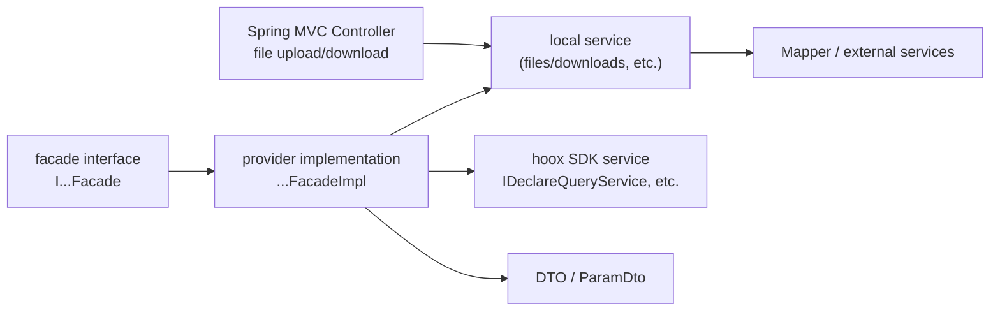
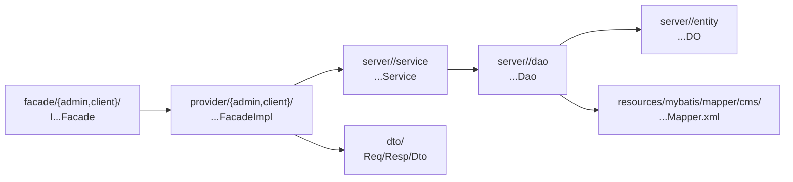

> This chapter is intended for `hoox-cap-backend` and `hoox-cms-backend`. The two projects share the same technical lineage (Spring Boot 2.7 + SOFA + JAX-RS), but their layering and persistence details differ; review the differences first, then write according to the template.

## 1. Technical Baseline

| Item | CAP | CMS |
| --- | --- | --- |
| Java | 21 | 21 |
| Spring Boot | 2.7.18 | 2.7.18 |
| SOFA Boot/RPC | 3.14.1 | 3.14.1 |
| Web/REST | JAX-RS + a small amount of Spring MVC | JAX-RS |
| ORM | MyBatis / MyBatis-Plus (SDK-dependent) | MyBatis-Plus |
| Database | GaussDB/PostgreSQL, schema `hoox_cap` | GaussDB/PostgreSQL, schema `hoox_cms` |
| Registry | ZooKeeper | ZooKeeper |
| Packaging | `gov-hoox-cap-run` fat jar, classifier `executable` | `hoox-cms-run` fat jar, classifier `executable` |
| Bootstrap class | `CapWebApplication` | `CmsWebApplication` |

For build commands and the profile mechanism, see [02-Integration and Configuration Standards](/2026/10/28/portal-integration-and-configuration-standards). This chapter covers code only.

## 2. Layering and Dependency Direction

### 2.1 CAP



CAP characteristics:

- Most business capabilities are in `hoox-common`/SDK; CAP providers mainly perform **parameter validation, logged-in user ownership checks, DTO conversion, and sensitive field sanitization**, then call SDK services.
- Only a few modules such as files have a local service/controller inside `online-server`.
- Facades and providers belong to two separate modules, `*-facade` and `*-server`.

### 2.2 CMS



CMS characteristics:

- A business domain keeps `dao`, `entity`, and `service` together under `server/<domain>`, with domain cohesion.
- Facades are split into `admin` and `client` sets: do not mix the admin backend and the Portal frontend.
- DTOs live in `dto/<domain>` of `hoox-cms-facade`; do not use DOs directly as interface responses.

### 2.3 Dependency Rules

| Rule | Description |
| --- | --- |
| facade depends only on DTOs/common libraries | The interface module does not depend on server implementations and does not contain DAO/DO |
| provider depends on service and does not write SQL directly | Queries/transactions are pushed down to the service; the provider handles orchestration and conversion |
| service depends on dao | One service can orchestrate multiple DAOs; cross-domain orchestration goes in the upper-layer service/facade |
| dao only performs persistence | No business branching, no calls to external services |
| entity only maps tables | Do not add Swagger/interface semantics; use DTOs for interfaces |
| controller is only used for MVC scenarios | File upload/download, forms/binary; do not add a Controller for ordinary JSON interfaces |

## 3. Steps to Add an Interface

### 3.1 CAP Query Interface (GET)

1. Create/extend `I...Facade` in the corresponding domain `facade` package of `gov-hoox-cap-online-facade`.
2. Annotate the class with `@Path`, `@Consumes`, `@Produces`, `@Tag`; annotate methods with `@GET`, `@Path`, `@Operation`.
3. Implement in the `provider` package of `gov-hoox-cap-online-server`, annotated with `@Service`, `@SofaService`.
4. Inject the SDK service and perform parameter validation, `AuthContextManager` ownership checks, and sensitive field sanitization.
5. Return `ResultDto<T>` or `ResultDataListDto<List<T>>`.
6. Add a whitelist/proxy entry in the BFF (see 02).
7. Add unit tests: normal, no permission, empty data, exception.

### 3.2 CAP Write Interface (POST)

- For input parameters, prefer `ParamDto<XxxReqDto>`, consistent with existing interfaces in the same domain.
- Write operations must confirm idempotency, duplicate submission, and draft/formal case status; do not assume the frontend calls only once.
- For local multi-table write operations that need transactions, add `@Transactional(rollbackFor = Exception.class)` on the service.
- Return `ResultDto<Boolean>` or a business result DTO; do not return the database affected row count to the frontend as the business result.

### 3.3 CMS client/admin Interfaces

1. Determine the caller: the Portal frontend uses `facade/client`, the admin backend uses `facade/admin`; do not expose admin interfaces to client for convenience.
2. Define interfaces and DTOs in `hoox-cms-facade`; client interfaces usually `extends BaseFacade`.
3. Implement in `provider/{admin/client}/<domain>` of `hoox-cms-server`, annotated with `@Service`, `@SofaService`.
4. Use `ParamValidUtil` for parameter validation (reuse existing regex constants in the same domain).
5. Business write operations go in `server/<domain>/service` with transactions; providers must not directly operate multiple DAOs.
6. Return `ResultDto`/`ResultDataListDto`, preferably using `CmsResultUtils`.
7. When adding tables/fields, synchronize `TableNameConst`, DO, DAO, Mapper XML, and SQL upgrade scripts.
8. Add unit tests covering invalid parameters, empty results, permission/ownership, and the normal path.

## 4. Naming Standards

### 4.1 Java Packages and Classes

| Object | Standard | Example |
| --- | --- | --- |
| Package | All lowercase, layered by business domain | `...cms.provider.client.article` |
| facade interface | `I` + domain + action + `Facade` | `ICmsClientArticleFacade` |
| facade implementation | Remove `I` + `Impl` | `CmsClientArticleFacadeImpl` |
| DTO | `XxxReqDto` / `XxxRespDto` / `XxxDto` | `AddArticleReqDto`, `CmsArticleDto` |
| Database entity | `XxxDO` | `CmsArticleDO` |
| DAO | `XxxDao` | `CmsArticleDao` |
| Service | `XxxService` | `CmsArticleService` |
| Parameter wrapper | `ParamDto<T>` | `ParamDto<AddArticleReqDto>` |
| Enum (dictionary) | `E` + domain + type + `Dict` | `ECmsArticleStatusDict` |
| Enum (error code) | `E` + domain + `ExceptionCode` | `ECmsExceptionCode` |
| Constant | `UPPER_SNAKE_CASE` | `CMS_ARTICLE`, `SOFA_SERVICE_TIMEOUT` |
| Table name constant | `CMS_` + table name | `CMS_ARTICLE` |
| Test | Name of the class under test + `Test` | `CmsClientArticleFacadeImplTest` |

Method naming:

- Query: `getXxx` (single), `queryXxx`/`listXxx` (list/conditional).
- Write: `addXxx`, `updateXxx`, `deleteXxx`, `saveXxx`.
- Boolean: `isXxx`, `hasXxx`, `canXxx`.
- Conversion: `convertXxx`, `toXxx`, `buildXxx`.
- Do not use names with no business meaning such as `doSomething` or `handleData`.

REST paths:

- All lowercase, segments separated by `-`, version last: `/hoox/cms/client/article/v1/article-list-query`.
- Common CAP prefixes: `/hoox/cap/online/pc/.../v1`, `/hoox/cap/withoutQuery/v1`, `/cap/online/pc/file/v1`.
- Common CMS prefixes: `/hoox/cms/client/.../v1`, `/hoox/cms/admin/.../v1`.
- Once a path changes, the frontend whitelist, backend authentication `authIncludeUrl`, and Nginx/gateway must all be updated in sync.

### 4.2 Database Naming

- Tables/fields: `snake_case`; table names carry a business prefix (`cms_`; on the `hoox_cap` side, follow existing tables).
- Primary key uniformly `unid`; status fields use `*_status`; logical deletion uses `deleted`; time uses `create_time`/`modify_time`.
- Java fields use camelCase and are explicitly mapped via `@TableField`; do not rely on guessing via automatic camel-case conversion.
- Table names must be added to `TableNameConst`; do not write string literals in `@TableName` or SQL.

## 5. Class Templates

> The following are "structural templates"; package names, types, and exception codes must be replaced with actual business ones; do not copy them directly and submit them as non-compilable examples.

### 5.1 Facade Interface

```java
package com.linewell.gov.hoox.cms.facade.client.demo;

import com.linewell.gov.hoox.cms.dto.demo.DemoRespDto;
import com.linewell.gov.hoox.cms.dto.demo.DemoSaveReqDto;
import com.linewell.gov.hoox.common.bean.ParamDto;
import com.linewell.gov.hoox.common.bean.ResultDto;
import com.linewell.gov.hoox.common.core.BaseFacade;
import com.linewell.gov.hoox.utils.exception.AppException;
import io.swagger.v3.oas.annotations.Operation;
import io.swagger.v3.oas.annotations.media.Schema;
import io.swagger.v3.oas.annotations.tags.Tag;

import javax.ws.rs.*;
import javax.ws.rs.core.MediaType;

@Path("/hoox/cms/client/demo/v1")
@Consumes(MediaType.APPLICATION_JSON)
@Produces(MediaType.APPLICATION_JSON)
@Tag(name = "IDemoFacade", description = "Demo client API")
public interface IDemoFacade extends BaseFacade {

    @GET
    @Path("/detail")
    @Operation(summary = "Get demo detail")
    ResultDto<DemoRespDto> getDemo(
            @Schema(description = "Demo ID", required = true, maxLength = 32)
            @QueryParam("unid") String unid) throws AppException;

    @POST
    @Path("/save")
    @Operation(summary = "Save demo")
    ResultDto<Boolean> saveDemo(
            @Schema(implementation = ParamDto.class)
            ParamDto<DemoSaveReqDto> paramDto) throws AppException;
}
```

Conventions:

- Place `@Path`/HTTP method/`@Consumes`/`@Produces`/Swagger annotations on the **interface**; implementation classes must not repeat `@Path`.
- Query parameters use `@QueryParam`, POST body uses `ParamDto<T>`; do not mix `@FormParam` and JSON body.
- The `pattern` of `@Schema` uses placeholders from the Swagger configuration (such as `${CASE_NUMBER_PATTERN}`); do not hard-code regular expressions.
- `throws AppException` is the business exception declaration; do not write `throws Exception` on the interface.

### 5.2 Provider Implementation

```java
package com.linewell.gov.hoox.cms.provider.client.demo;

import com.alipay.sofa.runtime.api.annotation.SofaService;
import com.alipay.sofa.runtime.api.annotation.SofaServiceBinding;
import com.linewell.gov.hoox.cms.facade.client.demo.IDemoFacade;
import com.linewell.gov.hoox.cms.server.demo.service.DemoService;
import com.linewell.gov.hoox.common.bean.ParamDto;
import com.linewell.gov.hoox.common.bean.ResultDto;
import com.linewell.gov.hoox.utils.HooxConstants;
import com.linewell.gov.hoox.utils.exception.AppException;
import com.linewell.gov.hoox.utils.log.ELog;
import com.linewell.gov.hoox.utils.log.Log;
import org.springframework.beans.factory.annotation.Autowired;
import org.springframework.stereotype.Service;

@Service
@SofaService(
        interfaceType = IDemoFacade.class,
        bindings = @SofaServiceBinding(bindingType = "rest", timeout = HooxConstants.SOFA_SERVICE_TIMEOUT)
)
public class DemoFacadeImpl implements IDemoFacade {

    @Autowired
    private DemoService demoService;

    @Override
    @Log(value = ELog.READ, name = "Get demo detail")
    public ResultDto<DemoRespDto> getDemo(String unid) throws AppException {
        // 1. Parameter validation
        // 2. Query/permission check
        // 3. DO -> DTO
        // 4. Return unified Result
        return null; // Replace with the actual return
    }

    @Override
    @Log(value = ELog.CREATE, name = "Save demo")
    public ResultDto<Boolean> saveDemo(ParamDto<DemoSaveReqDto> paramDto) throws AppException {
        // 1. Extract paramDto.getData() and validate
        // 2. Call the service (transaction in service)
        // 3. Return success
        return null; // Replace with the actual return
    }
}
```

> The `return null` in the template is only a placeholder and must be replaced with a real return before submission; production code must not keep a placeholder `return null`.

If a CAP provider provides both Bolt and REST:

```java
@SofaService(
    interfaceType = IOnlinePcSingleDeclareQueryFacade.class,
    bindings = {
        @SofaServiceBinding(bindingType = "bolt", timeout = HooxConstants.SOFA_SERVICE_TIMEOUT),
        @SofaServiceBinding(bindingType = "rest", timeout = HooxConstants.SOFA_SERVICE_TIMEOUT)
    }
)
```

- For HTTP frontend use only, `rest` is required; if there is no Bolt consumer, do not add Bolt.
- `interfaceType` must be the `Class` of the facade interface, not the implementation class.
- Some CAP implementation classes are annotated with both `@Service` and `@Component` (legacy style); new classes only need `@Service`; do not omit `@SofaService`.

### 5.3 DTO / ParamDto

```java
package com.linewell.gov.hoox.cms.dto.demo;

import io.swagger.v3.oas.annotations.media.Schema;
import lombok.Data;

@Data
@Schema(description = "Demo response")
public class DemoRespDto {
    @Schema(description = "Demo ID")
    private String unid;

    @Schema(description = "Demo name")
    private String demoName;
}
```

Rules:

- Request/response DTOs go in `dto/<domain>` of the facade module, not in `server`.
- Whether fields use wrapper types (`Integer`/`Boolean`) or primitive types should be consistent with existing DTOs in the same domain; pagination parameters commonly use `int`.
- Do not expose DO internal fields on DTOs (logical deletion, keys, approver identity, etc.).
- New fields must consider frontend compatibility: only add, do not rename; evaluate callers when deleting/changing types.

### 5.4 DO (CMS)

```java
package com.linewell.gov.hoox.cms.server.demo.entity;

import com.baomidou.mybatisplus.annotation.IdType;
import com.baomidou.mybatisplus.annotation.TableField;
import com.baomidou.mybatisplus.annotation.TableId;
import com.baomidou.mybatisplus.annotation.TableName;
import com.linewell.gov.hoox.cms.consts.TableNameConst;
import lombok.AllArgsConstructor;
import lombok.Data;
import lombok.NoArgsConstructor;

@Data
@NoArgsConstructor
@AllArgsConstructor
@TableName(TableNameConst.CMS_DEMO)
public class CmsDemoDO {

    @TableId(value = "unid", type = IdType.INPUT)
    private String unid;

    @TableField(value = "demo_name")
    private String demoName;

    @TableField(value = "deleted")
    private Integer deleted;

    @TableField(value = "create_time")
    private String createTime;

    @TableField(value = "modify_time")
    private String modifyTime;
}
```

Rules:

- `@TableId(type = IdType.INPUT)` means the ID is generated by business code; the existing CMS practice is `UUIDGenerate.getUnid()`; do not leave it to database auto-increment.
- Explicitly use `@TableField(value = "...")` for each field; do not rely on default camel-case mapping.
- Existing projects mostly use `String` for time fields (`yyyy-MM-dd HH:mm:ss` style); new fields should be consistent with the same table; do not have half `Date` and half `String`.
- DOs must not contain business methods; put conversions in provider/convert utilities.

### 5.5 DAO (CMS)

```java
package com.linewell.gov.hoox.cms.server.demo.dao;

import com.linewell.gov.hoox.cms.consts.TableNameConst;
import com.linewell.gov.hoox.cms.server.demo.entity.CmsDemoDO;
import com.linewell.gov.hoox.common.core.BasePlusDao;
import com.linewell.gov.hoox.utils.langshard.create.TableCreate;
import com.linewell.gov.hoox.utils.langshard.shard.TablePrepare;

@TablePrepare(
    appointTable = {TableNameConst.CMS_DEMO},
    enableStrongDataConsistency = false
)
@TableCreate(
    tableName = TableNameConst.CMS_DEMO,
    autoCreateTableMapperMethodName = "autoCreateTable"
)
public interface CmsDemoDao extends BasePlusDao<CmsDemoDO> {

    /** Used for automatic table creation for language table sharding */
    void autoCreateTable();
}
```

Rules:

- Only tables that need language table sharding should add `@TablePrepare`/`@TableCreate`; tables that do not need sharding (such as `cms_jump_link_whitelist`) must not copy this.
- The `autoCreateTable()` method name must match `autoCreateTableMapperMethodName`.
- Complex SQL goes in `hoox-cms-server/src/main/resources/mybatis/mapper/cms/<domain>/XxxMapper.xml`; do not write it in the `run` module.
- When a method has many parameters, use `@Param` to name them explicitly; do not rely on implicit naming for a single parameter/`Map`.
- Sort fields must be whitelist-validated; it is forbidden to splice the frontend `sortField` directly into `ORDER BY`.

### 5.6 Service (CMS)

```java
package com.linewell.gov.hoox.cms.server.demo.service;

import com.linewell.gov.hoox.cms.server.demo.dao.CmsDemoDao;
import com.linewell.gov.hoox.cms.server.demo.entity.CmsDemoDO;
import com.linewell.gov.hoox.common.core.BasePlusService;
import org.springframework.beans.factory.annotation.Autowired;
import org.springframework.stereotype.Service;
import org.springframework.transaction.annotation.Transactional;

@Service
public class DemoService extends BasePlusService<CmsDemoDao, CmsDemoDO> {

    @Autowired
    private CmsDemoDao demoDao;

    @Transactional(rollbackFor = Exception.class)
    public void saveDemo(CmsDemoDO demoDO) {
        // 1. Generate unid/time (using existing utilities in the same domain)
        // 2. Write the main table
        // 3. Write associated tables (if any)
    }
}
```

Rules:

- Transaction boundaries are in the service; providers must not be annotated with `@Transactional`.
- `@Transactional(rollbackFor = Exception.class)` is the existing style; do not only use the default `RuntimeException`.
- Self-invocation of methods within the same class will not trigger a new transaction; when an independent transaction is needed, split it into another Bean.
- Read-heavy, write-light configuration queries may use cache, but cache keys and invalidation timing must be consistent with existing implementations in the same domain.

### 5.7 Controller (MVC/File Scenarios Only)

```java
@RestController
@RequestMapping("/cap/online/pc/file/v1")
@Path("/cap/online/pc/file/v1")
@Tag(name = "Electronic Material Interface - Online PC End")
public class DemoFileController {

    @Log(value = ELog.CREATE, name = "Upload demo file")
    @PostMapping("/upload")
    @POST
    @Path("/upload")
    public ResultDto<List<MaterialFileResponseDto>> upload(
            @RequestParam("file") MultipartFile file,
            @QueryParam("projid") String projid) throws AppException {
        // Delegate to service; Controller contains no business logic
        return null;
    }
}
```

Rules:

- Do not use `@RestController` for ordinary JSON interfaces; only use it for files/forms/binary or scenarios requiring `MultipartFile`.
- Dual-stack classes must maintain both Spring and JAX-RS paths; changing one requires changing the other.
- File uploads must validate extension, size, and MIME; do not trust only the frontend.
- Downloads must correctly set `Content-Type`, `Content-Disposition`, and handle filename encoding.
- When `@Path` is on the class, the `authIncludeUrl` in the authentication configuration must cover this prefix (the CAP file path is `/cap/online/...`, not `/hoox/cap/...`).

### 5.8 Enums / Constants

```java
public enum ECmsDemoStatusDict {
    ENABLED("1", "Enabled"),
    DISABLED("0", "Disabled");

    private final String code;
    private final String info;

    ECmsDemoStatusDict(String code, String info) {
        this.code = code;
        this.info = info;
    }

    public String getCode() { return code; }
    public String getInfo() { return info; }
}
```

- Dictionary enums go in `com.linewell.gov.hoox.cms.enums.dict`; `@EnumsScanner` of `CmsWebApplication` scans that package; if placed in the wrong package, they will not be included in the dictionary.
- Error code enums go in `enums/code`, following the existing `@ACodeEnum` style; do not use magic strings.
- Table names go into `TableNameConst`; Redis keys go into `RedisKeyConst`; do not scatter them across business classes.

### 5.9 Unit Tests

```java
@ExtendWith(MockitoExtension.class)
class DemoFacadeImplTest {

    @Mock
    private DemoService demoService;

    @InjectMocks
    private DemoFacadeImpl facade;

    @Test
    void getDemo_shouldReturnWarnWhenNotFound() throws Exception {
        when(demoService.getById("x")).thenReturn(null);
        ResultDto<DemoRespDto> result = facade.getDemo("x");
        assertFalse(result.isFlag());
    }
}
```

Existing test styles:

- CAP commonly uses `@ExtendWith(MockitoExtension.class)`, `ReflectionTestUtils.setField` to inject `@Value` fields, and `mockStatic` to handle `AuthContextManager`/`LoggingApplicationManager`.
- CMS commonly directly `new`s the class under test + reflection/field assignment, and `mockStatic(RedisCacheUtil.class)`.
- Most provider logic can be covered without starting the Spring container; consider integration tests only when SQL/transactions need to be verified.
- Cover at least: success, business warn/fail, empty data, no permission, invalid parameters, external service exception.
- Static mocks must be closed in `@AfterEach` to avoid polluting other tests.

## 6. Annotation Responsibilities

| Annotation | Where Used | Purpose/Notes |
| --- | --- | --- |
| `@Path` | facade interface/file Controller classes and methods | Defines the REST path; interface and implementation must not repeat it |
| `@GET` / `@POST` | facade methods | HTTP methods; GET for queries, POST for writes |
| `@Consumes` / `@Produces` | facade classes | Fixed `application/json;charset=UTF-8` |
| `@QueryParam` | facade method parameters | Query parameters; use `ParamDto` for complex objects |
| `@Tag` / `@Operation` / `@Schema` | facade | Swagger documentation; write parameter constraints clearly |
| `@Service` | provider/service | Spring Bean |
| `@SofaService` | provider | Publishes the SOFA service; `interfaceType` must be an interface |
| `@SofaServiceBinding` | provider | `rest` for HTTP; `bolt` for RPC consumers |
| `@Autowired` | fields/constructors | Existing code mainly uses field injection; new code may use constructor injection |
| `@Value` | fields | Configuration injection; provide default values to avoid startup failures |
| `@Transactional` | service write methods | `rollbackFor = Exception.class` |
| `@TableName` | DO | Table name must use a constant |
| `@TableId` | DO primary key | `IdType.INPUT` |
| `@TableField` | DO fields | Explicit column name |
| `@TablePrepare` / `@TableCreate` | DAO | Language table sharding/automatic table creation |
| `@Log` | provider write/read methods | Operation logs; do not record sensitive data |
| `@EnumsScanner` | Bootstrap class | Scans the dictionary enum package |
| `@ACodeEnum` | Error code enum | Unified error codes/internationalization |

## 7. Response Envelope, Exceptions, and Internationalization

### 7.1 Response Envelope

| Scenario | Type | Notes |
| --- | --- | --- |
| Single object | `ResultDto<T>` | Put the object in `data` |
| List/pagination | `ResultDataListDto<List<T>>` | Requires `recordsTotal` |
| No data | `ResultUtils.queryNotFound()` / empty list | Do not return `null` |
| Business warning | `ResultUtils.warn(code, msg)` | Usually HTTP 200, `flag=false` |
| Business failure | `ResultUtils.fail(...)` / throw `AppException` | Converted by the framework into a unified error body |

CMS should prefer `CmsResultUtils`, which encapsulates `ResultUtils` and CMS error codes; do not directly `new ResultDto` in CMS.

### 7.2 Exceptions

- Business exceptions use `AppException` (CAP) or `CmsException` (CMS, extends `AppException`).
- Parameter validation exceptions use `CmsParamValidException` (CMS) or `AppException` + parameter error code.
- Do not catch `Exception` and return `success`; do not swallow external service exceptions.
- When additional context is needed, log it before rethrowing; do not change the original error code.
- Do not return stack traces, SQL, or internal URLs to the frontend.

### 7.3 Internationalization

- Error messages and prompt messages are taken from error code enums/`InternationUtils`; do not hard-code long Chinese/English sentences in Java.
- CAP's i18n resources are in `gov-hoox-cap-run/src/main/resources/i18n/.../message*.properties`; CMS's are in `hoox-cms-server/src/main/resources/i18n` (`message_*.properties`).
- When adding an error code, also add the resource file; if only the enum is added without translation, the frontend will get the code or an empty message.
- Logs may be in Chinese/English, but must not contain sensitive user information.

## 8. Persistence and SQL

### 8.1 MyBatis Configuration

| Item | CAP | CMS |
| --- | --- | --- |
| Mapper scanning | `@MapperScan("com.linewell.gov.hoox.**.dao")` | Configured by `CmsDataBaseConfig` |
| XML location | `classpath:mybatis/mapper/**/*.xml,mybatis/mapper/oauth/**/*.xml` | `classpath:mybatis/mapper/cms/**/*.xml` |
| Local XML | Not present in the current repository; capabilities are mostly in SDK jars | `hoox-cms-server/src/main/resources/mybatis/mapper/cms/**` |
| Global schema | Determined by the data source URL/configuration | `mybatis-plus.global-config.db-config.schema=dpmp` |

### 8.2 CMS Adding Tables/Fields

1. Add a constant in `TableNameConst` (unless it is explicitly not sharded).
2. Create `CmsXxxDO` with fields explicitly mapped via `@TableField`.
3. Create `CmsXxxDao extends BasePlusDao<CmsXxxDO>`; when language table sharding is needed, add `@TablePrepare`/`@TableCreate` and `autoCreateTable()`.
4. Write business logic in `server/<domain>/service`; add transactions for write operations.
5. For complex queries, add XML in `hoox-cms-server/src/main/resources/mybatis/mapper/cms/<domain>/` and declare methods in the DAO.
6. Add an upgrade script in `hoox-cms-backend/sql/gauss/` (naming follows `hoox-cms-<from>-upgrade-<to>.sql`); if language table sharding is involved, confirm that both the base table and the language tables are covered.
7. After startup, confirm that the language table creation logic of `CmsRunnerInit` reports no errors; it is enabled only when `hoox.lang.shard=Y`.
8. For changes that need rollback, also provide a rollback script (the existing repository has a `*-rollback-*.sql` precedent).

### 8.3 Language Table Sharding

- When `hoox.lang.shard=Y`, CMS startup scans DAOs annotated with `@TableCreate` under `com.linewell.gov.hoox.cms.server` and automatically creates multilingual tables.
- Table name constants use the base name (`cms_article`); do not manually append `_enus`/`_ardz`; the framework appends suffixes by language.
- Not all tables are language-sharded: the constant comment for `cms_jump_link_whitelist` explicitly states "single physical table, not language-sharded, no automatic creation of multilingual tables". New tables must clearly specify which category they belong to.
- Manual SQL must use actual physical table names (such as `"hoox_cms"."cms_article_ardz"`); do not assume that the base table can be automatically routed.

### 8.4 SQL Standards

- String concatenation of user input is forbidden; dynamic sort fields must be whitelisted.
- Pagination queries must limit `countPerPage` (CAP has a configuration precedent of `countPerPage.limit=200`).
- For fuzzy queries, confirm indexes/performance; do not perform unrestricted `%keyword%` scans on large tables.
- Logical deletion uniformly uses `deleted`, and queries include `deleted=0` by default; do not physically delete business data.
- Multi-table write operations go in the same transaction; for cross-service calls, do not assume that transaction rollback can cover remote failures; use compensation/state machines when necessary.
- New SQL must clearly state the schema; CMS's JDBC `currentSchema=hoox_cms` is inconsistent with MyBatis-Plus `schema=dpmp`, so hand-written SQL requires particular attention.

## 9. Logging, Security, and Performance

### 9.1 Logging

- Use `@Log(value = ELog.READ/CREATE/UPDATE/DELETE, name = "...")` for externally exposed methods; write the business action in name, not parameter values.
- Use `LogUtil.error` for exception logs with context (business ID, interface name); do not print the complete request body/response body.
- It is forbidden to record: passwords, tokens, RSA private keys, full ID card numbers, bank cards, detailed addresses, and user avatar binaries.
- When troubleshooting user issues, record the masked ID (such as `projid`); do not record the full `userCard`.

### 9.2 Security

- User data interfaces must verify ownership: CAP compares `AuthContextManager.getAuthContext()` with `extAccount`; CMS verifies by logged-in user/role.
- Do not trust `userId`, `websiteId`, or `deptId` passed from the frontend; all identifiers that can be passed from the frontend must undergo permission checks.
- File uploads validate extension/size/MIME; downloads perform permission checks to prevent unauthorized access to others' materials.
- Sensitive fields are sanitized before returning (CAP already has precedents such as `sanitizeSensitiveApproverInfo`).
- External URL calls must prevent SSRF: only allow whitelisted domains from the configuration; do not directly request arbitrary URLs provided by users.
- Logs/exception information must not leak internal addresses, SQL, or keys.

### 9.3 Performance

- List interfaces must be paginated; do not query the entire table at once.
- Avoid N+1: if it can be done in one SQL/batch query, do not query the database in a loop.
- Caches must have expiration and invalidation policies; actively clear the cache after updating configuration/content.
- For asynchronous/scheduled jobs, use the project's existing thread pool/scheduling configuration; do not casually `new Thread`.
- Set reasonable timeouts for external interfaces; do not wait indefinitely.

## 10. Difference Checklist Between CAP and CMS

| Dimension | CAP | CMS |
| --- | --- | --- |
| facade base class | Most do not extend `BaseFacade` | client usually `extends BaseFacade` |
| SOFA binding | Queries commonly use bolt + rest | client commonly uses rest |
| Business implementation | Mainly orchestrates SDK services | Local service/dao/entity |
| Result utility | `ResultUtils` + `ECAPExceptionCode` | `CmsResultUtils` + `ECmsExceptionCode` |
| Parameter validation | Hand-written + `@Schema` + business validation | `ParamValidUtil` + `@Schema` |
| Persistence | Depends on SDK/a small amount of local code | MyBatis-Plus + XML + language table sharding |
| File interfaces | Spring MVC + JAX-RS dual stack | Mainly JAX-RS; files have a separate dedicated implementation |
| Dictionary enums | SDK error codes/dictionaries | `@EnumsScanner` scans `enums.dict` |
| Typical tests | Mock SDK + static AuthContext | Mock DAO/Service + static Redis |

## 11. Pre-Submission Self-Check

- [ ] Is the `@Path` of the new interface consistent with the frontend/gateway/BFF whitelist?
- [ ] Are the facade interface and implementation in separate modules, and is the implementation annotated with `@SofaService`?
- [ ] Is the response envelope unified as `ResultDto`/`ResultDataListDto`, and is the total count set for lists?
- [ ] Do business exceptions use `AppException`/`CmsException` + error codes instead of returning `null`/`false`?
- [ ] Is ownership verified for user data, and are sensitive fields sanitized?
- [ ] Do write operations have transactions and idempotency/duplicate submission considerations?
- [ ] Are table names added to `TableNameConst`, and are fields explicitly mapped with `@TableField`?
- [ ] Do new tables/fields have SQL upgrade scripts, and is language table sharding handled?
- [ ] Are sorting/pagination/fuzzy queries safe and restricted?
- [ ] Have unit tests been added, and are static mocks closed?
- [ ] Have generated artifacts such as `target/`, `src/main/override/` been modified by mistake?
- [ ] Are configurations/keys only placeholders, with no real values written into code or documents?
