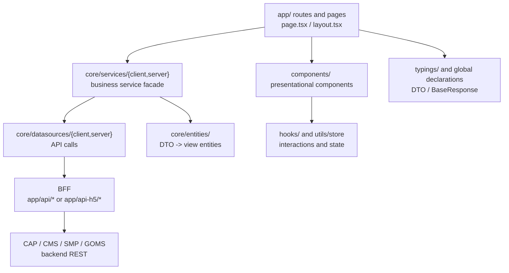
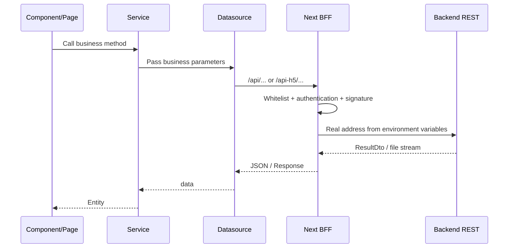

> Both frontends use the Next.js App Router, but their versions, component libraries, and authentication approaches differ: PC uses Next 16 + React 19 + antd 4, while H5 uses Next 14 + React 18 + antd 5/antd-mobile. **Do not copy PC code directly into H5, or vice versa.**
> For integration addresses and the environment variable list, see [02-Integration and Configuration Standards](/2026/10/28/portal-integration-and-configuration-standards).

## 1. Baseline Differences

| Item | `hoox-cms-pub-ui` (PC) | `hoox-cms-pub-app` (H5) |
| --- | --- | --- |
| Next.js | 16.4.1 | 14.2.25 |
| React | 19.2.0 | 18.2.0 |
| UI library | antd 4.24.15 | antd 5.14.2 + antd-mobile 5.34.0 |
| Authentication | NextAuth (OAuth `cms`) + CSRF + access token | CST SDK/native token + cookie, no NextAuth |
| Route prefix | `/{lang}/...` | `/h5/...` (`basePath: '/h5'`) |
| BFF prefix | `/api/*` | `/api-h5/*` |
| Internationalization | Lingui 5.6.1, 3 languages in production, plus `zh-cn` in development | Lingui 4.7.0, 3 languages in production, `zh-cn` not enabled |
| Package management | npm (enforced by `preinstall`) | npm |
| Node | `>=20.9.0` | `engines` not declared; execution follows the deployment environment |
| Build | `next build --webpack` + Lingui Babel preprocessing | `next build` + Lingui SWC plugin |
| Startup ports | dev 8080 / start 8000 / PM2 8300 | dev 8081 / start 8100 |
| Styling | SCSS Modules + antd 4 global CSS | SCSS Modules + antd 5 CSS-in-JS |

### 1.1 Points Not to “Upgrade and Align” Casually

- PC's antd 4 relies on a `rc-util` shim under React 19 (`next.config.js` maps `rc-util/es/React/render` to `src/shims/rc-util-react-render.js`). Removing this alias causes errors in the static `message`/`Modal` methods.
- PC's Next 16.3 is incompatible with the Lingui SWC plugin, so a Babel pre-pass expands the macros; H5 uses `experimental.swcPlugins`. Before changing the build chain, first confirm that the Lingui macros still compile.
- H5's `basePath: '/h5'` affects routes, static assets, BFF addresses, and `request.url`; new URLs must include `/h5`.
- Both `next.config.js` files set `eslint.ignoreDuringBuilds` and `typescript.ignoreBuildErrors`; a successful build **does not mean** that types/standards pass; `tsc` and `lint` must be run separately.

## 2. Frontend Layering



Responsibilities:

| Layer | Responsible for | Not responsible for |
| --- | --- | --- |
| `app/` | Routing, layouts, page composition, metadata | Complex business rules, assembling backend URLs directly |
| `components/` | Reusable UI, interactions, accessibility | Issuing requests directly, reading/writing cookies |
| `core/services/` | Business facade, composing multiple datasources, DTO→Entity | JSX, component state |
| `core/datasources/` | Single API call, URL, parameters, response unwrapping | Page navigation, Toast interactions |
| `core/entities/` | Default values, field mapping, view model | Network requests |
| `hooks/` | Reusable state/effects | Global singleton data (put it in store/context) |
| `utils/` | Pure functions, cookies, encryption, formatting | Business API orchestration |
| `typings/` | API DTOs, global types | Runtime code |

## 3. Directory and File Naming

### 3.1 Routes

- Directories use lowercase kebab-case: `citizen-services`, `my-applications`.
- Dynamic segments use `[id]`, `[...slug]`; route groups use `(common)`, and **route groups do not appear in the URL**.
- Page files are fixed: `page.tsx`, `layout.tsx`, `loading.tsx`, `error.tsx`, `not-found.tsx`.
- PC pages are all placed under `src/app/[lang]/`; H5 has no `[lang]` segment and determines the language from cookies/request headers.
- If a PC page contains client-side interactions, split it into `page.tsx` (Server Component) + `page.client.tsx` (`'use client'`); do not turn the whole page into a Client Component.
- H5's processing flow pages are in `src/app/service/{handle,patch,appeal,approve,receipt,view}`, and shared state is in `src/app/service/Provider.tsx`; when adding a step, update the Provider's steps/state at the same time; do not just add a page.

### 3.2 Components

- Component directories use kebab-case, and component files use PascalCase: `components/page-header/PageHeader.tsx`.
- Complex components use a directory + `index.tsx` export; simple components can be a single file.
- Use `index.module.scss` or `*.module.scss` in the same directory for styles; do not add new global class-name prefix conflicts.
- Put component prop types in `interface Props` in the same file; put externally exposed types in `types.ts` or `typings/`.
- Put static assets such as icons and images in `src/assets` or `public`; do not import an image from an undeclared remote domain.

### 3.3 Other

| Type | Standard | Example |
| --- | --- | --- |
| Hook | `use` + PascalCase, file name camelCase | `useI18nInit.ts` |
| Context | PascalCase + `Context`/`Provider` | `BuriedContext.tsx` |
| Store | `useXxxStore` (Zustand) | `utils/store/readMsgStore.ts` |
| Utility functions | camelCase file name | `authCheck.ts`, `getCookie.ts` |
| Constants | camelCase file name; export an UPPER_SNAKE constant or an `as const` object | `core/constants/smp/handleState.ts` |
| Type declarations | `*.d.ts` or `typings/*.ts` | `typings/global.d.ts` |
| BFF routes | `route.ts`; the directory is the URL | `app/api/cms-rest/[[...proxy]]/route.ts` |

## 4. TypeScript Standards

### 4.1 Basic Requirements

- `strict: true` is enabled; new code must not bypass it with `any`.
- Exported functions/service methods declare return types; short internal functions can infer.
- Use `import type` for type imports to avoid including types in the runtime.
- Prefer `interface` for object shapes; use `type` for unions/mapped/conditional types.
- Receive external data as `unknown`, then apply type guards; do not use `as any`.
- Annotate nullable fields truthfully as `string | null`; do not use non-null assertions `!` to hide the possibility that the backend does not return them.
- Use `as const` for constants to preserve literal types; do not add `enum` (existing code uses object constants; stay consistent).
- Do not use `Object`, `Function`, or `{}` as types; use `Record<string, unknown>` or an explicit interface.
- Do not use `namespace`; use ES Modules.
- Do not redefine public types: put backend DTOs in `typings/cmsApi.ts`/`smpApi.ts` or inside the datasource; put the global response in `global.d.ts`.
- File extensions: use `.tsx` only when the file contains JSX; use `.ts` for utilities, types, hooks, and services.

### 4.2 Response Types

PC's global response:

```ts
interface BaseResponse<T = unknown> {
  flag: boolean;
  message: string;
  errorCode: string;
  affectRows: number;
  recordsTotal: number;
  data: T;
}
```

H5's `global.d.ts` currently declares `data` as `T` without a generic; new code should explicitly declare a generic or override it in its own DTO:

```ts
interface CapResponse<T> {
  code?: string;
  flag: boolean;
  message?: string;
  errorCode?: string;
  data: T;
}
```

Note that the H5 CAP proxy normalizes POST responses to `{ code, flag, message, data, errorCode }` and **does not guarantee `affectRows`/`recordsTotal`**. Do not assume that this proxy always returns the total count for paginated lists; when the total count is needed, use the backend's original GET or a dedicated route.

### 4.3 Type Guards

```ts
function isRecord(value: unknown): value is Record<string, unknown> {
  return typeof value === 'object' && value !== null;
}

function getErrorMessage(error: unknown): string {
  if (isRecord(error) && typeof error.message === 'string') {
    return error.message;
  }
  return '';
}
```

Do not write `catch (e: any)`; default to `catch (e: unknown)`, then narrow.

## 5. Classes, Services, and Entities

### 5.1 When to Use a class

- **Always use function components for React components**; do not add class components.
- `core/services/*` uses a class to host a group of static methods, consistent with the existing `CmsService`/`CapService`.
- `core/entities/*` uses a class or factory function to express view entities; use a class for complex defaults/methods and a factory function for pure mapping.
- Error boundaries and utility classes can use classes; do not use a class as a mere data bag; prefer an `interface` + factory function.

### 5.2 Service Template

```ts
import { getDemo, type IGetDemoReq } from '@/core/datasources/server/demo';
import { createDemoEntity } from '@/core/entities/demo';

export class DemoService {
  public static readonly getDemo = async (params: IGetDemoReq) => {
    const dto = await getDemo(params);
    return createDemoEntity(dto);
  };
}
```

Rules:

- A Service only orchestrates/transforms; it does not contain JSX and does not directly read `window`/`document`.
- A `server` service can only be referenced by Server Components, Route Handlers, and Server Actions; it must not be imported by `'use client'` components.
- A `client` service can be referenced by client components/hooks; do not import server-only APIs such as `next/headers` and `cookies`.
- Keep static methods stateless; when cache/request context is needed, pass it explicitly; do not rely on module-level mutable variables.
- The existing `CmsService` has a historical spelling such as `getArticalDetail`; new code should use `Article`, and do not batch-rename existing exports just to "unify" unless all callers are updated in sync.

### 5.3 Entity Template

The existing `createArticleEntity` uses a "factory function + default values" pattern; continuing it is recommended:

```ts
import type { DemoDto } from '@/typings/demoApi';

export function createDemoEntity(props: Partial<DemoDto>) {
  return {
    unid: props.unid || '',
    demoName: props.demoName || '',
    enabled: props.enabled ?? false,
    tags: props.tags || [],
  };
}

export type DemoEntity = ReturnType<typeof createDemoEntity>;
```

Rules:

- For fields that the backend may return as `null`, provide safe defaults in the entity (`''`, `[]`, `0`, `false`) so pages no longer need null checks everywhere.
- Do not pass class instances directly to Client Components; Next serialization loses methods. Pass plain objects/arrays.
- Keep entity field names semantically aligned with the backend; do not rename them casually for UI convenience; map display names at the component layer.
- Keep the original types/strings for amounts, dates, and enum values; put formatting in `utils`; do not localize inside entities.

## 6. React / Next.js Standards

### 6.1 Server / Client Boundary

- Default to Server Components; add `'use client'` only when state, events, or browser APIs are needed.
- Put `'use client'` on the first line of the file (it may also precede comments, but do not put it after imports).
- Server Components can be `async`; do not use `async` for Client Components.
- PC's `params`/`searchParams` are Promises in Next 16 and must be `await`ed; H5 is Next 14, follow the existing synchronous style and do not copy it blindly.
- PC's `cookies()` is asynchronous (`await cookies()`); H5's `cookies()` is synchronous. Confirm the version before copying code across projects.
- H5's root `src/app/layout.tsx` is itself `'use client'`; do not use `next/headers`/server datasources inside it; if SEO metadata is needed, put it in a Server Component page and do not copy PC's Server Layout.
- Do not import `core/datasources/server`, `core/services/server`, or `next/headers` in Client Components.
- Do not pass access tokens, RSA private keys, or backend intranet addresses into Client Components; PC's `layout.tsx` already deletes `session.accessToken` before rendering; do not bypass this.

### 6.2 Page Templates

PC:

```tsx
// page.tsx (Server Component)
import PageClient from './page.client';
import { DemoService } from '@/core/services/server/demo';

export default async function Page() {
  const data = await DemoService.getDemo({ unid: 'x' });
  return <PageClient data={data} />;
}
```

```tsx
// page.client.tsx
'use client';

interface Props {
  data: DemoEntity;
}

export default function PageClient({ data }: Props) {
  return <div>{data.demoName}</div>;
}
```

H5:

```tsx
'use client';

import { useEffect, useState } from 'react';
import { DemoService } from '@/core/services/client/demo';

export default function Page() {
  const [data, setData] = useState<DemoEntity | null>(null);

  useEffect(() => {
    DemoService.getDemo({ unid: 'x' }).then(setData);
  }, []);

  if (!data) return null;
  return <div>{data.demoName}</div>;
}
```

Rules:

- Pages only fetch data, compose layout, and pass props; extract complex interactions into `components/` or `hooks/`.
- List rendering must provide a stable `key` (the business `unid`, not the array index).
- When using ternaries/`&&` for conditional rendering, be aware that `0`/`''` will be rendered; use explicit `Boolean()` when needed.
- Do not create large objects/arrays in render as props; use `useMemo` or compute them in advance.
- `useEffect` dependencies must be complete; cancel requests with an `AbortController` or a flag to avoid setState after unmount.
- Prefer `next/image` for images; PC has `qualities` configured as `[75,100]`; do not use an unconfigured quality.
- Prefer `next/link` for links; for new windows/external links, use a plain `<a>` with `rel="noopener noreferrer"`.
- Form submission must have loading, duplicate-submission prevention, and error messages; the button's disabled state must match the request state.

### 6.3 Routing and middleware

When adding a PC page:

1. Create the page at `src/app/[lang]/<route>/page.tsx`.
2. Add the corresponding path/regex to `validRoutes` in `src/middleware.ts`; otherwise it will be treated as an invalid route.
3. If mobile redirects are involved, update `MOBILE_REDIRECT_RULES` in sync (the comments require consistency with `layout.client.tsx`).
4. If navigation/breadcrumbs are involved, update the corresponding component or constant in sync.
5. If the page requires login, confirm that the `withAuth`/session logic covers it; explicitly add public pages to the exclusion paths.

When adding an H5 page:

1. Create the page under `src/app/...`; the URL automatically carries `/h5`.
2. If it uses `formCenter` or external forms, confirm the proxy rules in `middleware.ts`.
3. Processing flow pages must connect to the steps and state in `service/Provider.tsx`; do not maintain a separate set.
4. For pages that need the native container token, confirm the `UserService.getAppUserInfo`/`shouldAllowBusinessAccess` logic in `layout.tsx`.

### 6.4 State Management

- Use `useState`/`useReducer` for local state; use Context for cross-component state confined to one feature domain.
- Use Zustand for global client state; put stores in `src/utils/store/` (PC) or the corresponding feature directory (H5's `service/Provider.tsx`).
- Do not copy server data into the global store; if it can be fetched with a Server Component, fetch it on the server.
- Stores hold only UI state/session-scoped data; do not store tokens, passwords, or complete ID card details.
- The existing `AppProvider` contains global configuration/theme/language, etc.; evaluate SSR hydration issues when adding a new global provider.

## 7. Data Requests and BFF

### 7.1 Call Chain



### 7.2 Datasource Template

Client:

```ts
import { clientRequest } from '@/libs/request/client';
import type { DemoDto } from '@/typings/demoApi';

export interface IGetDemoReq {
  unid: string;
}

export interface IGetDemoRes extends BaseResponse<DemoDto> {}

export function getDemo(params: IGetDemoReq) {
  return clientRequest('/api/cms-rest/hoox/cms/client/demo/v1/detail', {
    params,
  }).then((response: IGetDemoRes) => response.data);
}
```

Server:

```ts
import { cookies } from 'next/headers';
import { serverRequest } from '@/libs/request/server';
import { getAuthString } from '@/utils/server/authCheck';
import { getCachedAuth } from '@/utils/server/cachedAuth';
import type { DemoDto } from '@/typings/demoApi';

export async function getDemo(params: { unid: string }) {
  const lang = (await cookies()).get(process.env.NEXT_PUBLIC_LANG_COOKIE_NAME as string)?.value || 'en-us';
  const session = await getCachedAuth();
  const headers = {
    'HOOX-AUTH': getAuthString(session, '/api/cms-rest', lang),
  };

  return serverRequest('/api/cms-rest/hoox/cms/client/demo/v1/detail', {
    params,
    headers,
  }).then((response: BaseResponse<DemoDto>) => response.data);
}
```

Rules:

- One function corresponds to exactly one backend API; write the complete URL (including the virtual prefix and backend path); do not concatenate unreadable strings.
- Use `params` (query) or `data` (body) for request parameters; do not handwrite `?a=1&b=2`.
- Unwrap responses in the datasource: pages receive `data`/Entity, not the whole envelope (except for paginated APIs that need `recordsTotal`).
- The global interceptor in `clientRequest` handles 401/429/duplicate submissions, etc.; do not pop the same error again at the business layer.
- When a specific call needs to be silent, use `options.hideMsg: true` (the existing `getSceneGuidePreview` sets a precedent); do not disable prompts globally.
- Do not assemble real backend addresses in the frontend; real addresses exist only in BFF environment variables.
- Use dedicated BFF routes or `FormData` for file upload/download; do not use the JSON proxy.
- Server-side requests must carry the language/client IP; the existing `serverRequest` adds headers such as `hoox-real-ip`; do not bypass it.

### 7.3 Responses and Errors

- Check the HTTP status first, then `flag`/`errorCode`; backend business failures may still return HTTP 200.
- When `flag=false`, do not swallow the error silently; when display is needed, use the backend `message` or local i18n copy.
- The global interceptor already handles 429, session expired, duplicate submissions, etc.; pages only handle their own business codes.
- Do not display every error as "System error"; report network errors, parameter errors, and permission errors separately.
- Legacy APIs may return `result_code: sys-400/sys-500`; the global interceptor is already compatible; new APIs should uniformly use `flag`/`errorCode`; do not introduce this legacy format.
- Do not print complete response bodies/request bodies in logs (they may contain personal information).

### 7.4 BFF Route Standards

Physical route locations:

- PC: `src/app/api/<service>/route.ts` or `src/app/api/<service>/[[...proxy]]/route.ts`.
- H5: `src/app/api-h5/<service>/route.ts` or `.../[[...proxy]]/route.ts`.
- Put file/streaming endpoints under the `(common)` route group (route groups do not affect the URL), for example PC's `src/app/api/(common)/cap-file-download/route.ts`.

Template (PC):

```ts
import type { NextRequest } from 'next/server';
import { serverRequest } from '@/libs/request/server';
import { addAuthHeader, withAuth } from '@/utils/server/authCheck';

const ALLOWED_PATHS = new Set([
  '/api/demo-rest/hoox/demo/v1/detail',
]);

export const GET = withAuth(
  addAuthHeader(async (request: NextRequest) => {
    const url = request.url.match(/\/api(\/.*|$)/)?.[0];
    if (!url || !ALLOWED_PATHS.has(url.split('?')[0])) {
      return new Response('Not Found', { status: 404 });
    }

    const data = await serverRequest(url, {
      method: 'GET',
      headers: request.headers,
    });
    return Response.json(data);
  }),
);
```

Rules:

- **Exact whitelist**: the existing proxy uses `path === allowedPath`, not prefix matching; new APIs must add the complete path.
- Maintain GET/POST whitelists separately; do not use one array for all methods.
- H5's `withAuth`/`addAuthHeader` are imported from `@/utils/server/apiPipe`; PC's from `@/utils/server/authCheck`; do not cross-reference them.
- Do not reverse the order of `withAuth(addAuthHeader(handler))`; `withAuth` handles session/CSRF/access token, and `addAuthHeader` handles RSA signing.
- Add `excludes` only for public APIs; `withAuth`'s `excludes` uses `request.url.includes(item)`, which is a very broad substring match; new exclusions must use complete paths, and short strings such as `/config` are forbidden.
- POST body parsing must be fault-tolerant (`request.json().catch(() => null)`); APIs requiring a verification code/SMS code must validate it in the BFF first, then forward.
- When the response contains `hoox-data-secret`, the original headers/body must be preserved (the existing proxy has a dedicated branch); do not change it to `Response.json` and lose the headers.
- Binary/file downloads return a `Response` or stream; do not use `JSON.stringify`.
- The proxy only forwards, authenticates, and performs necessary normalization; do not write business rules in the BFF.
- H5 CAP POST normalization is a **known exception**: it reassembles the backend `{code, flag, message, data, errorCode}` into the frontend format and does not preserve `affectRows`/`recordsTotal`; changing this behavior affects all H5 processing APIs.

### 7.5 Frontend Steps for Adding a Backend API

1. Confirm the backend path, HTTP method, and request/response fields; obtain the Swagger/Apifox documentation.
2. Confirm which backend the virtual prefix corresponds to (see 02); do not invent a new prefix.
3. Configure the corresponding `*_API_BASEPATH` in `.env.development`/`.env.production` (point to `127.0.0.1:<port>` locally).
4. Add the complete path to the BFF's `WHITELIST_GET_PATHS`/`WHITELIST_POST_PATHS`.
5. If the prefix is new, add a branch in `src/utils/server/rsaEncrypt.ts`; otherwise reuse the existing `cap-/cms-/smp-/goms-/form-` branches.
6. Write the call in `core/datasources/{client/server}`, then expose a business method in `core/services`.
7. Define Req/Res types in `typings` or inside the datasource; confirm the envelope fields.
8. Pages/components call only the Service; add i18n, empty state, error state, and loading.
9. Run `npx tsc --noEmit`, `npm run lint`, and the relevant Jest cases.
10. During integration, first check whether the BFF returns 404 (whitelist), 401/403 (authentication), or a signature error (RSA), then check the backend business code.

## 8. Authentication Standards

### 8.1 PC

- The browser accesses only the same-origin `/api/*`; the NextAuth session is managed by `src/auth.ts`.
- `getAuthString(session, path, lang)` generates `HOOX-AUTH` and can only be called on the server; do not expose it to the client.
- The request interceptor automatically sends `x-csrf-token`; the BFF's `withAuth` validates CSRF; clients must not bypass it.
- `layout.tsx` deletes `session.accessToken` before passing data to the client; new pages must not put the token back into props/context.
- OAuth callbacks, login-state polling, and logout are handled by the NextAuth route; business pages must not assemble `/api/auth/callback` themselves.
- `CLIENT_ID` must align with the backend's `hoox.oauth.auth.hooxAppAuthProvider.<clientId>`; changing the ID requires updating the backend public-key configuration in sync.

### 8.2 H5

- There is no NextAuth; user identity comes from the CST SDK/native container token, and `layout.tsx` writes a cookie and calls `UserService.getAppUserInfo`.
- `clientRequest` automatically sends `token`/`base-params`; the BFF's `withAuth` validates the token, and `addAuthHeader` generates `HOOX-AUTH`.
- When `APP_API_TOKEN_CHECK=true`, third-party token validation is performed; it is `false` locally, so do not use it to judge production behavior.
- `encryt_uf` is the encrypted user identifier cookie; do not decrypt or print it in the frontend.
- H5's `CLIENT_ID=hoox-cms-pub-app` differs from PC's `hoox-cms-pub-ui`; do not mix the two sets of `*_API_AUTH_K`.

### 8.3 General

- Do not store plaintext passwords, ID card details, or RSA private keys in the frontend; `*_API_AUTH_K` is used only for server-side signing.
- Do not treat `NEXT_PUBLIC_SECURITY_GLOBAL_CLOSE=true` as a long-term solution; currently both dev/prod in the repository are `true`, meaning request security mechanisms are globally disabled; this is the current state, not a recommended value, and must be confirmed before going live.
- Do not disable `NODE_TLS_REJECT_UNAUTHORIZED` to "solve" certificate problems; currently both dev/prod are set to `0`, which is a known risk; production should configure a trusted CA.
- External link redirects go through the existing `external-link` component/whitelist validation; do not call `window.open(userInput)` directly.

## 9. Configuration and Environment Variables

### 9.1 File Responsibilities

| File | Purpose | Note |
| --- | --- | --- |
| `.env.development` | Local development defaults | Currently committed in the repository, containing shared environment addresses and key-related configuration; do not add real secrets |
| `.env.production` | Production build defaults | `NEXT_PUBLIC_*` are fixed at build time; rebuild after changes |
| `.env.local` | Personal local overrides (if used) | Do not commit; takes precedence over `.env.development` |
| `next.config.js` | Build, images, SCSS, webpack, basePath | When changing the build chain, run regression tests for Lingui/antd/SSR |
| `src/middleware.ts` | Route validation, mobile redirects, H5 form proxy | PC new pages must be added to `validRoutes` |
| `src/i18n.ts` | Runtime locale list/default | Keep consistent with the locales in `lingui.config.js` |
| `lingui.config.js` | Extract/compile language packs | Adding a language requires adding the catalog at the same time |
| `src/auth.ts` | PC NextAuth/OAuth | PC only; H5 does not have this file |
| `ecosystem.config.js` | PM2 startup ports/instances | Change together with Nginx/gateway ports |

### 9.2 Naming Rules

| Type | Rule | Example |
| --- | --- | --- |
| Server-side backend address | `*_API_BASEPATH`, without `NEXT_PUBLIC_` | `CMS_REST_API_BASEPATH` |
| Browser-visible configuration | `NEXT_PUBLIC_*`, must be a safe value | `NEXT_PUBLIC_ROOT_WEBSITE_ID` |
| Signing private key | `*_API_AUTH_K`, server-side only | `CAP_API_AUTH_K` |
| OAuth | `OAUTH_APP_*` / `NEXTAUTH_*` | `OAUTH_APP_ID`, `NEXTAUTH_SECRET` |
| Switches | `*_ENABLE`/`*_CHECK`/`*_CLOSE`, with value `true`/`false` | `APP_API_TOKEN_CHECK` |

Rules:

- One configuration has only one name; do not add two synonymous keys such as `CMS_REST` and `CMS_REST_API_BASEPATH`.
- Before adding a `NEXT_PUBLIC_*` variable, confirm whether it will enter the browser bundle; never add intranet addresses, keys, or tokens.
- When adding a server-side key, update `.env.development`, `.env.production`, and the deployment configuration in sync; adding `.env.example` is recommended (the current repository does not have one).
- Do not write real keys into Markdown/examples; this document uses only `<...>` placeholders.
- The frontend recognizes only virtual prefixes (such as `/api/cms-rest`); do not directly read `CMS_REST_API_BASEPATH` to assemble URLs.

### 9.3 Minimal Changes for Local Integration

1. In `.env.development`, change `*_API_BASEPATH` to the local backend ports (CAP 8087/8346, CMS 8083/8343, with SMP/GOMS depending on the actual setup).
2. `NEXTAUTH_URL=http://localhost:8080` (PC).
3. If H5's `NEXT_PUBLIC_PROXY_CLOUD_FORM_HOST` is used for the Form Center, change it to a local/test address.
4. Confirm that the BFF whitelist includes the API to be called.
5. Confirm that the backend `authIncludeUrl`, frontend `CLIENT_ID`, and public/private keys match.
6. If the login callback fails, check whether the OAuth callback address matches `NEXTAUTH_URL`.

## 10. Internationalization, RTL, and Styling

### 10.1 i18n

- All user-visible copy goes through Lingui: `msg`/`Trans`/`useLingui`; do not hardcode Chinese/English/Arabic.
- PC production locales: `ar-dz`, `fr-fr`, `en-us`, default `ar-dz`; development additionally has `zh-cn` (pseudoLocale).
- In H5's `i18n.ts`, the `zh-cn` push is commented out; `lingui.config.js` still includes `zh-cn`. Do not assume that the H5 development environment can always access `/zh-cn`.
- After adding copy, run `npm run lingui:extract` and `npm run lingui:compile`; if you only change the code without compiling, the page displays the key/empty copy.
- Use interpolation for dynamic copy; do not concatenate sentences; Arabic/French word order differs.
- Use `Intl` or the project's existing formatting utilities for dates/numbers/currencies; do not handwrite `yyyy-mm-dd`.
- The `message` returned by the backend may be in the current language or may be an error code; the frontend should prioritize mapping `errorCode` to local copy to avoid inconsistency between the backend language and the page language.

### 10.2 RTL

- Arabic is the default language, and pages must support RTL; `<html dir>` is controlled by `useI18nInit`'s `direction`.
- Use logical properties in CSS: `margin-inline-start`, `padding-inline-end`, `inset-inline-start`; do not hardcode `left/right`.
- For icons/arrows that need mirroring, use the `[dir='rtl']` selector or `transform: scaleX(-1)`; not all icons should be mirrored (such as the play button).
- The close buttons/alignment of forms, tables, and Modals must be checked under RTL.
- When adding a language, verify all of the following: long-text wrapping, button width, date format, and number direction.

### 10.3 Styling

- Use SCSS Modules for component styles, with class names in camelCase; put global styles only in `src/styles/`.
- PC's `next.config.js` automatically injects `src/styles/index.scss` into every SCSS file; do not repeat `@import` of global variables in components.
- H5 uses the same automatic injection; antd 5 uses CSS-in-JS; do not additionally import antd 4's global CSS.
- Do not use `!important` to override antd; prefer `ConfigProvider` tokens/theme or local classes.
- PC antd 4's static `message`/`Modal` methods depend on the shim; new code should prefer the `App`/hook approach (if the project already has wrappers), avoiding direct static calls.
- Prefer project variables/theme for colors, font sizes, and spacing; new hardcoded colors must document their source.
- Images must have `alt`; decorative images use `alt=""`; clickable icons need `aria-label`.

## 11. Testing and Quality

### 11.1 Commands

```bash
npm run lint
npx tsc --noEmit
npm test -- --runInBand
npm run prettier
```

- The build scripts ignore TS/ESLint, so the above three must be run separately.
- PC's `lint` is `eslint` (defaults to the current directory); H5 is the same.
- Do not use `npm run build` in place of type checking; a successful build may have ignored errors.
- Before committing, at minimum run the Jest cases for the affected modules; changes to the BFF/authentication must add route-level tests or manual integration records.

### 11.2 Jest Standards

- Put tests in `src/__tests__/`, with the directory mirroring the source; file names are `*.test.ts(x)`.
- Use `@testing-library/react` to test behavior, not implementation details; prefer `getByRole`/`getByText`.
- Mock external dependencies: `next/navigation`, `next-auth/react`, `@linewell/request`, Lingui, and antd's `message`/`Modal`.
- Each test case must be independent; `beforeEach` cleans up mocks to avoid global singleton/cookie pollution.
- For asynchronous behavior, use `findBy*`/`waitFor`; do not use fixed `setTimeout`.
- Use snapshots only for stable small components; do not use snapshots on large pages in place of assertions.
- Do not use real user information as test data; use fake data such as `test-user` and `13800000000`.

### 11.3 Code Quality

- ESLint extends `alloy`/`alloy/react`/`alloy/typescript` and enables `simple-import-sort`; follow the existing import grouping and do not reorder manually.
- Use Prettier for consistent formatting; do not format the entire file in one PR, creating unrelated diffs.
- Do not leave `console.log` in production code; even when debugging with `console.error`, assess whether it leaks information.
- Do not commit `debugger`, `.only`, temporary mocks, or real tokens.
- Comments explain "why", not restate the code; complex compatibility logic (such as the React 19 shim) must document its background.

## 12. Performance and Maintainability

- Default to Server Components to reduce the client bundle; add `'use client'` only to interactive leaf nodes.
- Dynamically `import()` large components/heavy libraries (PDF, charts, editors), and provide loading/error fallbacks.
- For list pagination/virtual scrolling, follow existing component capabilities; do not render thousands of rows at once.
- Use `next/image` for images, with width/height/`sizes`; do not lazy-load large above-the-fold images.
- Caching: server-side public configuration can use `withCmsCache`, but do not cache user-related data; cache keys must include dimensions such as language/site.
- Avoid repeatedly creating antd `message`/`Modal` instances in render; use the project's wrappers.
- Lazy-load third-party scripts (tracking, customer service) so they do not block the first screen; the idle initialization in the existing `layout.client.tsx` is a reference.
- Remove unused dependencies/imports; before adding a dependency, confirm bundle size, license, and Node/browser compatibility.

## 13. Common Pitfalls

| Symptom | Cause | Resolution |
| --- | --- | --- |
| BFF returns 404 | The path is not in the whitelist, or the method does not match | Add the complete path to the corresponding GET/POST whitelist |
| BFF returns 401/403 | No session/token, CSRF failure, or access token expired | Check the login state, `x-csrf-token`, and BFF `withAuth` |
| Backend returns a signature error | `*_API_AUTH_K` does not match the backend public key, or the new prefix has no RSA branch | Align the clientId/public-private keys and add a branch to `rsaEncrypt.ts` |
| Local requests hit the shared environment | `.env.development` has not changed `*_API_BASEPATH` | Change to local addresses and restart the dev server |
| Changed `.env` does not take effect | `NEXT_PUBLIC_*` is injected at build time | Re-run `npm run dev`/`npm run build` |
| H5 page 404/asset 404 | Forgot the `/h5` prefix | All URLs/static assets must include `basePath` |
| H5 paginated total lost | CAP POST proxy normalization does not preserve `recordsTotal` | Use GET or a dedicated BFF route |
| PC new page 404 | middleware `validRoutes` not updated | Add the route/regex and restart |
| Copy displays a key | `lingui:compile` not run, or catalog not added | Extract/compile and check the locale |
| Arabic layout misaligned | Hardcoded `left/right` | Change to logical properties and regress under RTL |
| Build passes but types are wrong | `ignoreBuildErrors: true` | Run `npx tsc --noEmit` separately |
| `message`/`Modal` errors | React 19 rc-util shim deleted/broken | Restore the `next.config.js` alias |

## 14. Pre-commit Self-check

- [ ] Pages prioritize Server Components, with `'use client'` added only to leaf nodes that need interaction?
- [ ] Requests go Service → Datasource → BFF, with no component connecting directly to the backend?
- [ ] New APIs have been added to the BFF whitelist, with the method/path matching exactly?
- [ ] New prefixes have an RSA branch, and the clientId/public-private keys match the backend?
- [ ] Responses are handled by `flag`/`errorCode`, without assuming that HTTP 200 means success?
- [ ] No new `any`/non-null assertions were added to types, and `npx tsc --noEmit` passes?
- [ ] Copy goes through Lingui, and `lingui:extract/compile` has been run?
- [ ] RTL, mobile, empty state, error state, and loading have all been checked?
- [ ] PC new pages have been added to middleware `validRoutes`; H5 URLs carry `/h5`?
- [ ] No token/key/intranet address has been placed in `NEXT_PUBLIC_*` or client components?
- [ ] Tests pass, and no `.only`/`debugger`/real user data has been committed?
- [ ] The `next.config.js` shim/basePath/build chain has not been modified by mistake, or a complete regression has been performed?
