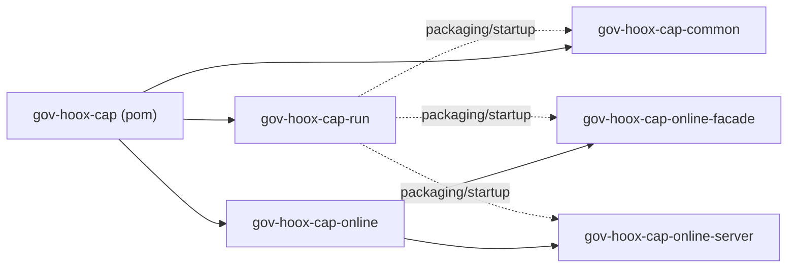
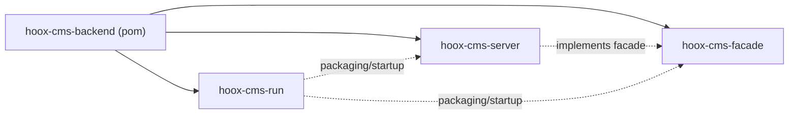

> This chapter answers three questions: **what this directory is for, where new code goes, and which directories must not be edited by hand.**
> The directories are based on the current `master` branch of the four repositories; only directories that actually exist in the repositories are listed, and generated artifacts (`target/`, `.next/`, `node_modules/`) are not expanded. Directory purposes are summarized primarily from class names, route names, and code comments; anything that cannot be determined from the name alone is marked in the notes.

## 1. How to Choose Among the Four Repositories

| Repository | Role | When to change it |
| --- | --- | --- |
| `hoox-cap-backend` | One of Portal's backends, providing declaration, materials, licenses, payment, appointment, correction, and other capabilities | Change declaration/processing APIs, CAP business orchestration, file upload/download |
| `hoox-cms-backend` | Portal admin backend + Portal client content APIs | Change sites/columns/content/tags/sensitive words/customer service/redirect whitelist |
| `hoox-cms-pub-ui` | Portal PC | Change PC pages, PC BFF, NextAuth login |
| `hoox-cms-pub-app` | Portal H5 | Change H5 processing flow, H5 BFF, CST/native login |

For the overall architecture and terminology, see [01-System Overview and Terminology](/2026/10/28/portal-system-overview-and-terminology); for integration configuration, see [02-Integration and Configuration Standards](/2026/10/28/portal-integration-and-configuration-standards); for coding standards, see [03-Backend Development Standards](/2026/10/28/portal-backend-development-standards) and [04-Frontend Development Standards](/2026/10/28/portal-frontend-development-standards).

## 2. hoox-cap-backend

### 2.1 Top Level

```text
hoox-cap-backend/
├─ cert/                       # Redis/ZooKeeper TLS certificate store (JKS)
├─ gov-hoox-cap-common/        # Common foundation package: error codes, constants, data sources, UAM
├─ gov-hoox-cap-online/        # Online declaration capabilities: facade + server
│  ├─ gov-hoox-cap-online-facade/
│  └─ gov-hoox-cap-online-server/
├─ gov-hoox-cap-run/           # Bootstrap module, configuration resources, fat jar
├─ updatesql/                  # CAP database upgrade scripts
├─ pom.xml                     # Aggregation/dependency versions/Profile
├─ CHANGELOG.md
└─ README.md
```

| Directory/File | Purpose | Note |
| --- | --- | --- |
| `cert/` | `redis-*.jks`, `zookeeper-*.jks`, used for TLS mutual authentication | Sensitive material; do not copy to the frontend/documentation/public logs; confirm repository access permissions |
| `gov-hoox-cap-common/` | Error codes, constants, data source configuration, and common online-offline integration APIs reused across modules | Do not put specific declaration business here; business code goes in `online` |
| `gov-hoox-cap-online/` | Parent module for CAP online capabilities | Aggregation only; specifics are in facade/server |
| `gov-hoox-cap-run/` | Bootstrap class, `application*.properties`, i18n, packaging | Do not put business code here; for configuration changes see 02 |
| `updatesql/` | CAP SQL upgrade scripts, currently only `4.0.0/hoox_cap.sql` | When adding tables/fields, add the corresponding version document; do not only change the DO |
| `pom.xml` | Java 21, Spring Boot 2.7.18, SOFA 3.14.1, `hoox-common` version | Full regression is required when changing dependency versions |

### 2.2 Module Relationships



> The diagram above shows build/run relationships, not a strict Maven dependency graph; for specific dependencies, refer to each `pom.xml`.

### 2.3 `gov-hoox-cap-common`

```text
src/main/java/com/linewell/gov/hoox/cap/
├─ base/
│  ├─ code/                    # CAP base enums: download source, department type, tags, window binding, etc.
│  ├─ constants/               # CapConstants, RedisKeyConst
│  └─ datasource/              # CapDataBaseConfig (data source/MyBatis configuration)
└─ onlineofflinecommon/
   ├─ facade/config/dto/       # Online-offline common configuration DTOs
   └─ server/uam/service/      # UAM user/organization integration services
```

| Package | Purpose | Should new code go here? |
| --- | --- | --- |
| `base/code` | Cross-domain base enums | Only if shared by multiple domains |
| `base/constants` | Global constants, Redis keys | Cross-domain constants go here; single-domain constants go in the domain |
| `base/datasource` | CAP data source initialization | Do not write business SQL here |
| `onlineofflinecommon/facade/config/dto` | Online-offline common configuration API DTOs | Common configuration DTOs may go here |
| `onlineofflinecommon/server/uam/service` | UAM integration | Change only when UAM-related |

### 2.4 `gov-hoox-cap-online-facade`

```text
src/main/java/com/linewell/gov/hoox/cap/online/
├─ common/captcha/dto/         # Common captcha DTOs
└─ pc/
   ├─ book/                    # Appointment
   ├─ captcha/                 # Image/SMS captcha
   ├─ file/                    # File download token, file DTOs
   ├─ license/                 # Electronic license/cloud license
   ├─ single/
   │  ├─ appeal/               # Appeals
   │  ├─ declare/              # Declaration (query/processing)
   │  ├─ evaluate/             # Evaluation
   │  ├─ matter/               # Matters
   │  ├─ patch/                # Correction
   │  └─ pay/                  # Payment
   ├─ supplement/              # Supplementary materials
   ├─ window/                  # Service outlets/windows
   └─ without/                 # External system calls (including ROMA eligibility verification)
```

| Directory | Purpose | Typical API prefix |
| --- | --- | --- |
| `book` | Appointment processing, bookable time slots | `/hoox/cap/book/handle/v1` |
| `captcha` | Image captcha | `/hoox/cap/online/pc/captcha` |
| `file` | Download token, file metadata | `/hoox/cap/online/pc/file/download` |
| `license` | Cloud license query/download/authorization | `/hoox/cap/online/pc/license/cloud` |
| `single/appeal` | Appeal application/details/buttons | `/hoox/cap/online/pc/single/appeal/v1` |
| `single/declare` | Declaration drafts, forms, materials, results, statistics | `/hoox/cap/online/pc/single/declare/v1` |
| `single/evaluate` | Case evaluation | `/hoox/cap/online/pc/single/evaluate/v1` |
| `single/matter` | Matter/service scenario configuration | `/hoox/cap/online/pc/config/service/v1` |
| `single/patch` | Correction form/details | `/hoox/cap/online/pc/single/patch/v1` |
| `single/pay` | Payment information, order placement, payment status | `/hoox/cap/online/pc/single/pay/v1` |
| `supplement` | Supplementary material confirmation/form | `/hoox/cap/online/pc/single/supplement/v1` |
| `window` | Service outlet/window details | `/hoox/cap/online/pc/window/v1` |
| `without` | External system/ROMA calls; whether login is exempt depends on the provider's `authIncludeUrl` | `/hoox/cap/withoutQuery/v1` |

> The paths of the file upload/download Controllers are `/cap/online/pc/file/v1` (Spring MVC + JAX-RS dual stack), and they are not within the `/hoox/cap/...` namespace in the table above.

Conventions:

- APIs go in `facade`, implementations go in `server`; facade does not depend on server.
- Interface class names are `I...Facade`, and paths carry the version `v1`; for specific standards see [03-Backend Development Standards](/2026/10/28/portal-backend-development-standards).
- `without` is an entry point for external systems and cannot be treated as login-exempt across the board: the PC/H5 providers explicitly allow only `getSignature`, while the global `hoox.oauth.auth.include.url` also includes `/hoox/cap/withoutQuery/v1/.*`; before adding an API, you must check both the provider's `authIncludeUrl` and the global include.

### 2.5 `gov-hoox-cap-online-server`

```text
src/main/java/com/linewell/gov/hoox/cap/online/
├─ common/                     # Common services/utilities: captcha, PDF conversion, windows
└─ pc/
   ├─ book/provider/           # Appointment implementation
   ├─ captcha/provider/        # Captcha implementation
   ├─ file/
   │  ├─ controller/           # Spring MVC + JAX-RS dual-stack file APIs
   │  ├─ provider/             # Download token, etc.
   │  └─ service/              # File download/material processing
   ├─ license/provider/        # Cloud license implementation
   ├─ single/
   │  ├─ appeal/               # Appeal implementation
   │  ├─ bill/                 # Receipts/bills
   │  ├─ declare/              # Declaration implementation
   │  ├─ evaluate/             # Evaluation implementation
   │  ├─ matter/               # Matter implementation
   │  ├─ pay/                  # Payment implementation
   │  ├─ provider/             # Single-domain common provider
   │  └─ supplement/           # Supplementary submission implementation
   ├─ window/provider/         # Service outlet implementation
   └─ without/                 # External system implementation
```

| Directory | Purpose |
| --- | --- |
| `common` | Cross-domain services/utilities such as captcha, PDF conversion, and windows |
| `book/provider` | Appointment facade implementation |
| `captcha/provider` | Captcha facade implementation |
| `file/controller` | File upload/download MVC APIs; also carries JAX-RS annotations |
| `file/provider` | Facade implementations such as file tokens |
| `file/service` | File download and material processing business |
| `license/provider` | Cloud license facade implementation |
| `single/*` | Facade implementations for each declaration subdomain; `bill/controller` contains document/receipt APIs (`/cap/online/pc/single/bill/v1`) |
| `window/provider` | Service outlet facade implementation |
| `without` | External system/ROMA facade implementation |

Notes:

- The path of `file/controller` is `/cap/online/pc/file/v1`, not `/hoox/cap/...`; the authentication configuration's `authIncludeUrl` must cover it.
- CAP has no local MyBatis mapper XML; most business queries are in the SDK/`hoox-common` services; before adding local SQL, first confirm the mapper scan path.
- `single/bill` does not create separate APIs in the facade's `single` subdirectory; bill APIs may be carried by `declare` or the file domain; search the existing paths before adding.

### 2.6 `gov-hoox-cap-run`

```text
src/main/
├─ java/com/linewell/gov/hoox/cap/run/
│  ├─ CapWebApplication.java   # Bootstrap class
│  └─ config/JobConfig.java    # Scheduled job configuration
└─ resources/
   ├─ common/                  # Common configuration (data sources, OAuth, gateway, CAP addresses, etc.)
   ├─ dev/                     # Local/development environment overrides
   └─ i18n/                    # Internationalization resources
```

| Directory | Purpose |
| --- | --- |
| `java/.../run` | Only startup, global configuration, and job configuration |
| `resources/common` | Configuration shared by all environments; `application.properties` is here |
| `resources/dev` | Configuration overridden when the Maven `dev` profile is active |
| `resources/i18n` | Internationalization resources for CAP error messages/prompts |

The current repository only has the `common` and `dev` resource directories; the `test/prod/huawei/dm` profiles declared in `pom.xml` have no corresponding resource directories, so confirm before switching profiles (see 02).

### 2.7 Where CAP New Code Goes

| What you want to add | Put it here |
| --- | --- |
| New REST API | `gov-hoox-cap-online-facade/.../pc/<domain>/facade` |
| API DTO | The same domain's `dto` or the facade module's common DTO package |
| API implementation | `gov-hoox-cap-online-server/.../pc/<domain>/provider` |
| Local business service | The same domain's `service` |
| File upload/download Controller | `.../pc/file/controller` (MVC scenarios only) |
| Cross-domain constants/error codes | `gov-hoox-cap-common/.../base/{constants,code}` |
| SQL upgrade | `updatesql/<version>/hoox_cap.sql` |
| Unit tests | The corresponding module's `src/test/java/...`, with package names mirroring the main code |

## 3. hoox-cms-backend

### 3.1 Top Level

```text
hoox-cms-backend/
├─ cert/                       # Redis/ZooKeeper TLS certificate store (JKS)
├─ hoox-cms-facade/            # Admin/client APIs + DTOs
├─ hoox-cms-server/            # Implementations, domain services, DAO, Mapper, i18n
├─ hoox-cms-run/               # Bootstrap module, configuration resources, fat jar
├─ sql/gauss/                  # CMS initialization/upgrade/rollback scripts
├─ pom.xml
└─ README.md
```

| Directory/File | Purpose | Note |
| --- | --- | --- |
| `cert/` | Redis/ZooKeeper TLS JKS | Sensitive material; do not share externally |
| `hoox-cms-facade/` | Only APIs and DTOs, no implementations | admin/client must be separated |
| `hoox-cms-server/` | Business implementations, DAO, Mapper, i18n | Domain cohesion: one directory per domain |
| `hoox-cms-run/` | Bootstrap class, configuration, packaging, `override` | Do not put business code here |
| `sql/gauss/` | GaussDB initialization/upgrade/rollback scripts | Scripts must be added for new tables/fields |

### 3.2 Module Relationships



### 3.3 `hoox-cms-facade`

```text
src/main/java/com/linewell/gov/hoox/cms/
├─ facade/
│  ├─ admin/                   # Admin backend APIs
│  │  ├─ article/              # Content management
│  │  ├─ authorization/        # Authorization management
│  │  ├─ chat/                 # Customer service/conversations
│  │  ├─ clean/                # Data cleanup
│  │  ├─ column/               # Columns
│  │  ├─ complain/             # Inquiries and complaints
│  │  ├─ dept/                 # Departments
│  │  ├─ dict/                 # Dictionary
│  │  ├─ file/                 # Files
│  │  ├─ jumplink/             # Redirect link whitelist
│  │  ├─ link/                 # External links
│  │  ├─ system/               # Site configuration
│  │  ├─ tag/                  # Tags
│  │  ├─ topic/                # Topics
│  │  ├─ website/              # Sites
│  │  └─ word/                 # Hot words/sensitive words/filter words
│  └─ client/                  # Portal client APIs
│     ├─ article/              # Published content
│     ├─ authorization/        # Authorization
│     ├─ captcha/              # Captcha
│     ├─ chat/                 # Customer service
│     ├─ collect/              # Favorites
│     ├─ column/               # Columns
│     ├─ complain/             # Inquiries and complaints
│     ├─ dept/                 # Departments
│     ├─ dict/                 # Dictionary
│     ├─ file/                 # Files
│     ├─ jumplink/             # Redirect whitelist validation
│     ├─ smp/                  # SMP matter services
│     ├─ system/               # Site configuration
│     ├─ topic/                # Topics
│     └─ word/                 # Hot words
└─ dto/                        # Req/Resp/DTOs corresponding to facade
```

| Directory | Purpose | Note |
| --- | --- | --- |
| `facade/admin` | Admin write operations/configuration queries | Do not expose to the Portal client |
| `facade/client` | Portal client read-only/submission | Do not reuse admin write APIs |
| `facade/client/smp` | Fetch service data from SMP/Matter Center | Depends on external systems; pay attention to degradation |
| `dto` | API transfer objects | Do not put DO/Entity here |

When adding APIs, create separate admin and client packages; do not mount admin APIs under the client path for the sake of "reuse".

### 3.4 `hoox-cms-server`

```text
src/main/java/com/linewell/gov/hoox/cms/
├─ chat/                       # WebSocket sessions, Redis broadcast, message services
├─ config/                     # Thread pool, file paths, open authentication, WebSocket configuration
├─ consts/                     # Table names, Redis keys, i18n constants
├─ datasource/                 # Data sources, MyBatis-Plus, pagination interceptor
├─ depend/                     # External dependencies: files, GOMS, SMP, URLs
├─ enums/
│  ├─ code/                    # Error codes/warning codes
│  ├─ constant/                # Business constant enums
│  └─ dict/                    # Dictionary enums (scanned by @EnumsScanner)
├─ exception/                  # CmsException, parameter validation exceptions
├─ init/                       # Startup initialization (CmsRunnerInit)
├─ job/                        # Scheduled jobs
├─ provider/
│  ├─ admin/                   # Admin facade implementations
│  └─ client/                  # Client facade implementations
├─ server/                     # Domain layer: dao/entity/service
├─ utils/                      # Result, date, file, encryption, external link validation, etc.
└─ ...
```

#### Domain Layer `server/`

| Directory | Purpose | Subdirectories |
| --- | --- | --- |
| `article` | Content, content column/tag associations, operation logs | `dao`, `entity`, `service` |
| `authorization` | NIN/NIF authorization | `dao`, `entity`, `service` |
| `chat` | Customer service conversations, members, messages | `dao`, `entity`, `service` |
| `collect` | Favorites | `dao`, `entity`, `service` |
| `column` | Columns | `dao`, `entity`, `service` |
| `complain` | Inquiries and complaints | `dao`, `entity`, `service` |
| `dept` | Department queries/organization information | `service` |
| `dict` | Dictionary | `scanner`, `service` |
| `file` | File metadata | `dao`, `entity`, `service` |
| `jumplink` | Redirect link whitelist | `dao`, `entity`, `service` |
| `system` | Site/footer/system configuration | `dao`, `entity`, `service` |
| `tag` | Tags | `dao`, `entity`, `service` |
| `topic` | Topics/topic services | `dao`, `entity`, `service` |
| `website` | Sites | `dao`, `entity`, `service` |
| `word` | Hot words, filter words, sensitive words | `dao`, `entity`, `sensitive`, `service` |
| `anync` | Currently an empty directory, no code found | Do not treat it as an async entry point; async is in `config/AsyncThreadPoolConfig` |

#### Support Packages

| Directory | Purpose | Typical Classes |
| --- | --- | --- |
| `chat` (root) | WebSocket sessions, Redis subscription/broadcast, online customer service messages | `AdminChatMessageSocket`, `ClientChatMessageSocket`, `SessionManager` |
| `config` | Global configuration | `AsyncThreadPoolConfig`, `CmsFilePathConfig`, `CmsOpenAuthConfig`, `CmsWebSocketConfig` |
| `consts` | Table name/Redis key/i18n constants | `TableNameConst`, `RedisKeyConst`, `I18nConst` |
| `datasource` | Data source/MyBatis-Plus | `CmsDataBaseConfig`, `MybatisPlusInterceptorConfig` |
| `depend` | External system adaptation | `DependFileManager`, `DependGomsManager`, `DependSmpManager`, `DependUrlManager` |
| `enums/code` | Error codes/warning codes | `ECmsExceptionCode`, `ECmsWarnCode` |
| `enums/constant` | Business constant enums | File business types, etc. |
| `enums/dict` | Dictionary enums | `ECmsArticleStatusDict`, etc. |
| `exception` | CMS exceptions | `CmsException`, `CmsParamValidException` |
| `init` | Startup initialization | `CmsRunnerInit` (language table sharding, filter words, Redis heartbeat, WebSocket, consultation cache) |
| `job` | Scheduled jobs | `FinishTimeoutChatJob`, `HotWordStatisticsJob` |
| `provider/admin` | Admin implementations | Mirrors facade by domain |
| `provider/client` | Client implementations | Mirrors facade by domain |
| `utils` | Common utilities | `CmsResultUtils`, `DateUtil`, `FileSecurityValidator`, `ExternalLinkWhitelistValidator`, `UUIDGenerate` (SDK) |

#### Resources `hoox-cms-server/src/main/resources`

```text
resources/
├─ i18n/                       # message_*.properties
└─ mybatis/mapper/cms/         # Mapper XML organized by domain
```

- Mapper XML goes in `mybatis/mapper/cms/<domain>/`, not in `hoox-cms-run`.
- i18n goes in `i18n/`; currently there are `message_ar_DZ`, `message_en_US`, `message_fr_FR`, etc.
- `hoox-cms-run/src/main/resources` has only `common`, `dev`, `META-INF`; do not assume that i18n is in the run module.

### 3.5 `hoox-cms-run`

```text
src/main/
├─ java/.../cms/run/CmsWebApplication.java   # Bootstrap class
├─ resources/
│  ├─ common/                                # Common configuration
│  ├─ dev/                                   # dev overrides
│  └─ META-INF/rpc-config.json               # SOFA RPC configuration
└─ override/                                 # Third-party class overrides extracted from hoox-oauth-server
```

| Directory | Purpose | Note |
| --- | --- | --- |
| `CmsWebApplication.java` | Startup, `@ComponentScan`, cache/enums/scheduling | Do not add business logic |
| `resources/common` | Data source, Redis, OAuth, dependencies, MyBatis, and other configuration | For configuration standards see 02 |
| `resources/dev` | Local data source/devops overrides | dev only |
| `resources/META-INF/rpc-config.json` | SOFA RPC configuration | Keep in sync when changing ports/protocols |
| `src/main/override` | Java override classes extracted from `hoox-oauth-server` at build time | **Do not edit by hand**; overwritten on every build; change the upstream dependency if a change is truly needed |

### 3.6 Where CMS New Code Goes

| What you want to add | Put it here |
| --- | --- |
| Admin APIs | `hoox-cms-facade/.../facade/admin/<domain>` |
| Client APIs | `hoox-cms-facade/.../facade/client/<domain>` |
| API DTOs | `hoox-cms-facade/.../dto/<domain>` |
| API implementations | `hoox-cms-server/.../provider/{admin/client}/<domain>` |
| Domain services/DAO/DO | `hoox-cms-server/.../server/<domain>/{service,dao,entity}` |
| Mapper XML | `hoox-cms-server/src/main/resources/mybatis/mapper/cms/<domain>` |
| Table names/Redis keys | `hoox-cms-server/.../consts` |
| Dictionaries/error codes | `.../enums/dict`, `.../enums/code` |
| External system adaptation | `.../depend` |
| Scheduled jobs | `.../job` |
| Startup initialization | `.../init/CmsRunnerInit` (be careful: a startup failure affects the whole site) |
| SQL upgrade | `sql/gauss/hoox-cms-<from>-upgrade-<to>.sql` |
| Unit tests | `hoox-cms-server/src/test/java/...`, with package names mirrored |

## 4. hoox-cms-pub-ui (PC)

### 4.1 Top Level

```text
hoox-cms-pub-ui/
├─ .husky/                     # Git hooks (commit-msg/pre-commit)
├─ .vscode/                    # Editor configuration
├─ patches/                    # patch-package patches
├─ public/                     # Static files served as-is (favicon, etc.)
├─ schemas/                    # Collection of API JSON Schemas (GET/POST/WEBSOCKET subdirectories)
├─ scripts/                    # Build/validation/theme scripts
├─ src/                        # Source code
├─ .env.development            # Default development environment configuration
├─ .env.production             # Default production build configuration
├─ ecosystem.config.js         # PM2 configuration (8300)
├─ next.config.js              # Next build/images/SCSS/webpack
├─ lingui.config.js            # Lingui extraction/compilation
├─ jest.config.js              # Jest
├─ tailwind.config.js          # Tailwind
├─ tsconfig.json               # TS configuration
├─ package.json                # Scripts/dependencies
├─ package-lock.json
└─ README.md
```

| Directory/File | Purpose | Note |
| --- | --- | --- |
| `.husky/` | Pre-commit lint/commit message validation | Do not bypass the hook when committing |
| `.vscode/` | Team editor settings | Do not force personal preferences on others |
| `patches/` | `patch-package` fixes for third-party packages | Patches may stop working after dependency upgrades; verify them |
| `public/` | Static files served as-is | Currently only favicon/placeholder images; most business images are in `src/assets` |
| `schemas/` | JSON Schemas for each BFF route (PC splits them into GET/POST/WEBSOCKET directories) | No references were found in the current source code; whether they must be synchronized after route changes is to be confirmed; do not treat this as runtime validation |
| `scripts/` | Version number stripping, Lingui fixes, BPJS sync, antd theme | Do not change build scripts arbitrarily |
| `src/` | Application source code | See below |
| `.env.*` | Environment variables | Already committed, containing shared environment addresses and key-type configuration; do not add real keys to the repository |
| `ecosystem.config.js` | PM2 cluster, port 8300 | Consistent with Nginx/gateway |
| `next.config.js` | `reactStrictMode:false`, ignoring build-time lint/TS, image quality, SCSS injection, React 19 shim | Regression-test antd/Lingui when changing webpack aliases |
| `lingui.config.js` | locale, catalog paths, pseudoLocale | Synchronize `src/i18n.ts` when adding languages |
| `jest.config.js` | jsdom, `@/` alias, testMatch | Tests go in `src/__tests__` |
| `tailwind.config.js` | Tailwind scan scope/theme | Coordinate with SCSS variables |
| `tsconfig.json` | strict, `@/*`, client-kit alias | Do not disable strict |

### 4.2 `src/` Overview

```text
src/
├─ __tests__/                  # Jest tests, mirroring the source directories
├─ app/                        # App Router: pages + BFF + static SDK routes
├─ assets/                     # Images, fonts, shared resources grouped by language/type
├─ components/                 # 61 reusable component directories
├─ contexts/                   # React Context (currently BuriedContext)
├─ core/                       # constants/datasources/entities/services
├─ hooks/                      # Custom hooks
├─ libs/                       # request, client-kit wrappers
├─ locales/                    # Lingui .po language packs
├─ middlewares/                # Non-routing middleware utilities (refreshToken)
├─ shims/                      # Third-party compatibility shims
├─ styles/                     # Global SCSS/antd styles
├─ template/                   # Print templates (by language)
├─ typings/                    # API/global types
├─ utils/                      # client/server/store utilities
├─ i18n.ts                     # Runtime locale configuration
└─ middleware.ts               # Next middleware (route validation/mobile redirect)
```

| Directory | Purpose | Should new code go here? |
| --- | --- | --- |
| `__tests__` | Unit/component tests | Put tests here; directories mirror the source code |
| `app` | Routes, pages, BFF | Put new pages/routes here |
| `assets` | Images/fonts/shared resources | Put static assets here or in `public` |
| `components` | Reusable UI | Put common components here |
| `contexts` | Global Context | Only for cross-page state |
| `core` | Business core (constants/data sources/entities/services) | Put business logic here |
| `hooks` | Reusable hooks | Put common hooks here |
| `libs` | Request library wrappers | Do not write business logic here |
| `locales` | `.po` language packs | Maintain with Lingui/Crowdin |
| `middlewares` | Non-routing middleware utilities | Currently only `refreshToken.ts` |
| `shims` | Compatibility layer | Third-party compatibility code only |
| `styles` | Global styles | Global variables/resets go here |
| `template` | Payment success print templates | Add HTML by language |
| `typings` | Types | API DTOs/global types go here |
| `utils` | Utilities | Keep pure functions/client/server/store separate |
| `i18n.ts` | Locale list/default value | Change this when adding languages |
| `middleware.ts` | Route validation/mobile redirect | Must be changed when adding pages |

### 4.3 `src/app` Routes

```text
app/
├─ [lang]/                     # All PC pages (with language prefix)
│  ├─ (home)/                  # Home page route group
│  ├─ [...notFound]/           # Fallback 404
│  ├─ callback-pages/          # Payment results, license detail callbacks
│  ├─ citizen-services/        # Citizen services
│  ├─ enterprise-services/     # Enterprise services
│  ├─ government-citizen-interaction/  # Government-citizen interaction/feedback
│  ├─ grayscale-release/       # Grayscale release description/entry
│  ├─ policies-regulations/    # Policies and regulations
│  ├─ search/                  # Search
│  ├─ sector-services/         # Sector services
│  ├─ service/                 # Cases: apasinfo/handle/patch
│  ├─ user-account/            # User account center
│  └─ zone/                    # Zones
├─ api/                        # PC BFF
├─ bpjs/                       # Tracking SDK static route
└─ pdfjs/                      # PDF.js static route
```

| Directory | Purpose | Note |
| --- | --- | --- |
| `[lang]` | Language-prefixed routes | `ar-dz`/`fr-fr`/`en-us`, plus `zh-cn` in development |
| `(home)` | Home page route group | Grouping does not affect the URL |
| `[...notFound]` | Fallback for unmatched paths | Do not write business logic here |
| `callback-pages` | Payment results, license details | Related to mobile redirect rules |
| `citizen-services` | Citizen services topic page | Data comes from CMS topics |
| `enterprise-services` | Enterprise services topic page | Same as above |
| `government-citizen-interaction` | Government-citizen interaction/feedback | Includes `feedback` |
| `grayscale-release` | Grayscale release | Page entry |
| `policies-regulations` | Policies and regulations/content details | Content comes from CMS |
| `search` | Site-wide search | Hot words/search APIs |
| `sector-services` | Sector services | Aggregated by department |
| `service` | Case process | `apasinfo`/`handle`/`patch` |
| `user-account` | User account center | My Cases/Bills/Licenses/Favorites/Messages, etc. |
| `zone` | Zones | Aggregated by region/topic |
| `api` | BFF | See 4.4 |
| `bpjs` | Tracking SDK | `createBpjsRouteHandler()` |
| `pdfjs` | PDF.js static assets | `createPdfjsRouteHandler()` |

`user-account` subdirectories:

| Directory | Purpose |
| --- | --- |
| `(basic-information)` | Basic Information route group |
| `account-setting` | Account Settings |
| `components` | User account center local components |
| `electronic-certificate` | Electronic Licenses |
| `favorite-list` | Favorites |
| `my-appeals` | My Appeals |
| `my-applications` | My Cases |
| `my-bill` | My Bills |
| `my-feedback` | My Feedback |
| `my-legal` | Legal Entity Information |
| `my-messages` | My Messages |
| `my-reservation` | My Reservations |
| `service-evaluation` | Service Evaluation |

### 4.4 `src/app/api` (PC BFF)

```text
api/
├─ (common)/                   # File upload/download, health check (route group, does not affect the URL)
├─ apiaccess/uv/               # UV statistics proxy
├─ auth/[...nextauth]/         # NextAuth login/callback/session
├─ cap-rest/                   # CAP proxy + dedicated routes
├─ cms-rest/                   # CMS proxy + dedicated routes
├─ csm-tpaccess/               # HWBP proxy
├─ form-rest/file-download/    # Form Center file download
├─ goms-rest/                  # GOMS messages/dictionary
├─ smp-rest/                   # SMP service list
├─ user/                       # Users, legal entities, authorization, captcha, messages
└─ [[...slug]]/route.ts        # Unified 404 for unmatched APIs
```

| Directory | Purpose | Note |
| --- | --- | --- |
| `(common)` | File upload/download, PDF generation, health check | The route group does not create a URL prefix; the actual URLs are `/api/cap-file-upload`, etc. |
| `apiaccess/uv` | UV statistics | Reads `APIACCESS_UV_URL` |
| `auth/[...nextauth]` | NextAuth | Custom GET/POST, CSRF, callback validation |
| `cap-rest` | CAP API proxy | Generic `[[...proxy]]` + multiple dedicated routes |
| `cms-rest` | CMS API proxy | Generic `[[...proxy]]` + topics/favorites/complaints/redirect validation, etc. |
| `csm-tpaccess` | HWBP tracking proxy | `[[...proxy]]` |
| `form-rest` | Form Center | File download |
| `goms-rest` | GOMS messages/dictionary | Multiple dedicated routes |
| `smp-rest` | SMP service list | Dedicated routes |
| `user` | Users/legal entities/authorization/captcha | Named by action |
| `[[...slug]]` | Fallback 404 | Do not add business logic here |

> The BFF has many leaf directories, and they change as APIs are added or removed; this section groups them by service. A leaf directory name states the API purpose (such as `complain-add` and `license-list`), and no itemized list is maintained. When adding an API, **do not** add only a datasource without adding a whitelist entry; the generic proxy only allows exact paths.

### 4.5 `src/components` (61)

| Directory | Purpose |
| --- | --- |
| `antd-trigger-child` | antd trigger child node wrapper |
| `apasinfo-lifecycle` | Case lifecycle display/mobile modal |
| `app-provider` | Global App Provider (theme/language/configuration) |
| `application-select-modal` | Case selection modal |
| `breadcrumb` | Breadcrumb |
| `button` | Common button |
| `card-select` | Card selection |
| `carousel` | Carousel |
| `checkbox-button` | Checkbox button |
| `cloud-license` | Cloud license modal/direct license retrieval |
| `cms-file-image` | CMS file image |
| `cms-url-image` | CMS URL image |
| `coming-soon-modal` | "Coming soon" modal |
| `department-cascader` | Department cascader |
| `dept-select-debounce` | Debounced department select |
| `dept-tree-select-cline` | Department tree select (the directory name is a historical spelling) |
| `empty` | Empty state |
| `error-draft` | Draft error state |
| `error-result` | Error result page |
| `external-link-modal` | External link confirmation modal |
| `external-link-provider` | External link interception Provider |
| `feedback-modal` | Feedback modal |
| `fix-aria-select` | Accessibility fix for Select/Cascader |
| `gotoServiceHandle-prompt` | Go to processing prompt modal |
| `guide-center` | Service guide center |
| `guide-step` | Guide step |
| `hot-search` | Hot search |
| `hyperlink-modal` | Hyperlink confirmation modal |
| `image-viewer` | Image preview |
| `lazy-background-image` | Lazy-loaded background image |
| `link` | Link wrapper |
| `modal` | Common Modal |
| `modal-confirm` | Confirmation Modal |
| `modal-footer` | Modal footer |
| `modal-tip` | Tip Modal |
| `online-service` | Online customer service/chat |
| `page-footer` | Page footer |
| `page-header` | Page header/navigation |
| `page-title` | Page title |
| `pagination` | Pagination |
| `pdf-viewer` | PDF preview |
| `portal-services-page` | Portal services topic page client |
| `query-table` | Query table/list |
| `scene-guidance` | Scenario guidance Q&A |
| `sector-service-card` | Sector service card |
| `service-card` | Service card |
| `service-header` | Service detail header |
| `service-select-debounce` | Debounced service select |
| `service-select-modal` | Service selection modal |
| `service-tree` | Service tree |
| `services-favoris-modal` | Favorite services modal |
| `side-bar` | Sidebar |
| `space` | Spacing layout |
| `sso-service-card` | SSO service card |
| `swiper-pic` | Carousel image |
| `tab-bar` | Tab bar |
| `tab-status` | Status tag |
| `unauthorized-prompt` | Unauthorized prompt |
| `web-page-to-file` | Web page to PDF/print |
| `with-authorized` | Login/permission wrapper (client/server versions) |
| `zone-header` | Zone page header |

### 4.6 `src/core`

```text
core/
├─ constants/                  # Common, list, language, CMS/SMP/user/payment, etc. constants
├─ datasources/
│  ├─ client/                  # Browser-side API calls
│  └─ server/                  # Server Component / Route Handler API calls
├─ entities/                   # DTO -> view entities/default values
└─ services/
   ├─ client/                  # Client-side business facade
   └─ server/                  # Server-side business facade
```

| Directory | Purpose | Rule |
| --- | --- | --- |
| `constants` | Enumerated values, status mappings, language mappings, URL constants | Do not write request logic |
| `datasources/client` | `clientRequest` calls the BFF | Only for client components/hooks |
| `datasources/server` | `serverRequest` + `HOOX-AUTH` + cache | Only for Server Components/BFF |
| `entities` | Default values, DTO→view objects | Do not make network requests |
| `services/client` | Client-side business methods | Compose datasource/entity |
| `services/server` | Server-side business methods | Do not export to the client |

Order for adding an API: `datasource` → `service` → page/component; do not call datasource directly from pages (there are a few existing exceptions; do not let new code spread them).

### 4.7 Other `src` Directories

| Directory | Purpose | Key Point |
| --- | --- | --- |
| `hooks` | `useAutoLogout`, `useI18nInit`, `useRouter`, `useUserIdle`, etc. | Do not stuff common logic into pages |
| `contexts` | `BuriedContext` | Tracking context |
| `libs/request` | `client.ts`/`server.ts` request wrappers | Global interceptors/security configuration |
| `libs/client-kit` | `@linewell/client-kit` external link guard wrapper | The webpack alias points here |
| `utils/client` | Browser utilities such as cookie, sign-out, CSRF, external links, tracking | Cannot use `next/headers` |
| `utils/server` | Server-side utilities such as authentication, RSA, cache, i18n, CMS cache | Must not enter the client bundle |
| `utils/store` | Zustand store | Only store UI/session-scoped state |
| `typings` | `cmsApi.ts`, `smpApi.ts`, `global.d.ts`, `next-auth.d.ts`, `env.d.ts` | API types and global declarations |
| `locales` | `.po` files for `ar-dz`/`fr-fr`/`en-us`/`zh-cn` | Maintain with Lingui/Crowdin; do not edit compiled artifacts by hand |
| `styles` | `globals.scss`, `var.scss`, `antd.css`, etc. | Global styles/variables |
| `template` | Payment success print templates (HTML by language) | Add the corresponding template when adding a language |
| `shims` | `rc-util-react-render.js` | React 19 + antd 4 compatibility; do not delete |
| `middlewares` | `refreshToken.ts` | Different from the root `middleware.ts` |
| `assets` | By language/images/shared resources | Processed at build time, not `public` |

### 4.8 Where PC New Code Goes

| What you want to add | Put it here |
| --- | --- |
| New page | `src/app/[lang]/<route>/page.tsx` (+ `page.client.tsx`) |
| New route validation | `validRoutes` in `src/middleware.ts` |
| New component | `src/components/<kebab-case>/` |
| New hook | `src/hooks/useXxx.ts` |
| New API call (client) | `src/core/datasources/client/` |
| New API call (server) | `src/core/datasources/server/` |
| New business service | `src/core/services/{client/server}/` |
| New view entity | `src/core/entities/` |
| New BFF route | `src/app/api/<service>/.../route.ts` + whitelist |
| New global type | `src/typings/` |
| New copy | `msg`/`Trans` in components, then run Lingui |
| New test | `src/__tests__/` mirrored directory |

## 5. hoox-cms-pub-app (H5)

### 5.1 Top Level

```text
hoox-cms-pub-app/
├─ .husky/
├─ .vscode/
├─ patches/
├─ public/
├─ schemas/
├─ scripts/
├─ src/
├─ .env.development
├─ .env.production
├─ ecosystem.config.js         # PM2 8100
├─ next.config.js              # basePath: '/h5'
├─ lingui.config.js
├─ jest.config.js
├─ tailwind.config.js
├─ tsconfig.json
├─ package.json
├─ package-lock.json
├─ yarn.lock                   # Two sets of lockfiles exist at the same time
└─ README.md
```

| Directory/File | Purpose | Note |
| --- | --- | --- |
| `patches/` | patch-package patches | H5's patches for antd 5/axios, etc. differ from PC |
| `schemas/` | H5 route JSON Schemas | Paths have an `h5-` prefix; no references were found in the current source code |
| `scripts/` | Version number stripping, CST SDK copying, dompurify cleanup, type validation | `copy-cstoon-jssdk.js` is related to the native container |
| `public/` | Static files served as-is | Currently only placeholder images; PDF/BPJS are served by app routes |
| `ecosystem.config.js` | PM2 cluster, port 8100 | Consistent with the `/h5` reverse proxy |
| `next.config.js` | `basePath:'/h5'`, Lingui SWC, ignoring build-time lint/TS, server externals | Changing basePath affects all URLs |
| `package-lock.json` + `yarn.lock` | Two sets of lockfiles | The current scripts use npm; before changing dependencies, confirm which set CI/deployment uses, and mixing them is prohibited |

### 5.2 `src/` Overview

```text
src/
├─ __tests__/                  # Jest tests
├─ app/                        # App Router: pages + H5 BFF + static SDK
├─ assets/                     # Fonts/shared resources
├─ components/                 # 15 reusable component directories
├─ contexts/                   # BuriedContext
├─ core/                       # constants/datasources/services
├─ hooks/                      # useI18nInit/useUserIdle
├─ libs/request/               # H5 request wrappers
├─ locales/                    # Lingui .po
├─ styles/                     # Global styles
├─ types/                      # Jest type declarations
├─ typings/                    # Global types/client-kit declarations
├─ utils/                      # client/server/store
├─ i18n.ts                     # Runtime locale
└─ middleware.ts               # formCenter proxy
```

| Directory | Purpose | Difference from PC |
| --- | --- | --- |
| `app` | Pages/BFF/static SDK | No `[lang]`; URLs carry `/h5` |
| `assets` | Fonts, shared resources | Fewer per-language image directories than PC |
| `components` | Mobile components | 15, mainly antd-mobile |
| `core` | Constants/data sources/services | No `entities` directory |
| `types` | `jest.d.ts` | PC does not have it |
| `typings` | Global types | No `cmsApi.ts`/`smpApi.ts` |
| `middleware.ts` | `formCenter` proxy | Does not handle language prefixes |
| `libs` | Only `request` | PC also has `client-kit` |
| `styles` | Global SCSS | No PC's `template`/`shims`/`middlewares` |

### 5.3 `src/app` Routes

```text
app/
├─ api-h5/                     # H5 BFF
├─ bpjs/                       # Tracking SDK static route
├─ callback-pages/             # Payment results
├─ license/                    # License preview
├─ pdfjs/                      # PDF.js static assets
├─ service/                    # Processing flow (handle/patch/appeal/approve/receipt/view)
├─ unauthorized/               # Unauthorized page
└─ layout.tsx                  # Root layout ('use client')
```

| Directory | Purpose | Note |
| --- | --- | --- |
| `api-h5` | H5 BFF | Prefix `/h5/api-h5` |
| `bpjs` | Tracking SDK | `createBpjsRouteHandler()` |
| `callback-pages/payment-result` | Payment results | The native container redirects here |
| `license` | Licenses | Includes `preview` license preview |
| `pdfjs` | PDF.js | Static assets |
| `service` | Main processing flow | See below |
| `unauthorized` | Unauthorized | Redirected here when access is not permitted |
| `layout.tsx` | Root layout | Client component, including token/user initialization |

`service` subdirectories:

| Directory | Purpose |
| --- | --- |
| `appeal` | Appeals |
| `approve` | Approval/review-related pages |
| `components` | Processing flow local components (result pages, etc.) |
| `handle` | Main processing page |
| `patch` | Correction |
| `receipt` | Receipt/acceptance |
| `view` | Case viewing |
| `Provider.tsx` | Processing flow shared state/steps |
| `layout.tsx` | Processing flow layout |

The steps/states of the H5 processing flow are in `service/Provider.tsx`: `sceneGuidance`, `fillForm` (may include `materialUpload`), `inProcess`, `result`; when adding steps, you must also change constants such as `HandleState`/`MaterialPhase`, not just add components.

### 5.4 `src/app/api-h5` (H5 BFF)

```text
api-h5/
├─ (common)/                   # File upload/download, health check
├─ cap-rest/                   # CAP proxy + dedicated routes
├─ cms-rest/                   # Redirect whitelist validation
├─ csm-tpaccess/               # HWBP proxy
└─ user/                       # app user information/keys/SMS
```

| Directory | Purpose | Note |
| --- | --- | --- |
| `(common)` | File upload/download/PDF/health check | The route group does not create a URL prefix |
| `cap-rest` | Generic CAP proxy + dedicated routes | POST normalizes the response |
| `cms-rest` | Redirect link whitelist validation | No generic CMS proxy |
| `csm-tpaccess` | HWBP tracking | `[[...proxy]]` |
| `user` | `app-get-k`, `app-user-info`, SMS | Related to native token |

H5 does not have generic physical routes such as PC's `/api-h5/smp-rest` and `/api-h5/goms-rest`; although the environment variables contain SMP/GOMS addresses, do not assume that a corresponding BFF necessarily exists. Add one following the existing `cap-rest` pattern when needed.

### 5.5 `src/components` (15)

| Directory | Purpose |
| --- | --- |
| `app-provider` | Global App Provider |
| `coming-soon-modal` | Coming soon modal |
| `error-result` | Error result page |
| `external-link-modal` | External link confirmation modal |
| `external-link-provider` | External link interception Provider |
| `hyperlink-modal` | Hyperlink confirmation modal |
| `inner-popup` | Embedded popup layer |
| `modal-common` | Common Modal |
| `modal-img` | Image modal |
| `modal-tip` | Tip modal |
| `navigat-head-modal` | Navigation header modal |
| `pdf-viewer` | PDF preview |
| `scene-guidance` | Scenario guidance Q&A |
| `title-popup` | Title popup |
| `web-page-to-file` | Web page to PDF/print |

### 5.6 Other H5 `src` Directories

| Directory | Purpose |
| --- | --- |
| `core/constants` | Processing status, material phase, payment, language, user constants |
| `core/datasources/client` | Browser-side API calls |
| `core/datasources/server` | Server-side API calls (if any) |
| `core/services/client` | Client-side business facade (`CapService`, `UserService`) |
| `core/services/server` | Server-side business facade (if any) |
| `hooks` | `useI18nInit`, `useUserIdle` |
| `libs/request` | `clientRequest`/`serverRequest` |
| `utils/client` | cookie, authGate, CST, Toast, external links |
| `utils/server` | `apiPipe`, RSA, authentication |
| `utils/store` | Zustand (such as `declareTimeStore`) |
| `typings` | Global types/client-kit declarations |
| `types` | Jest types |
| `locales` | `.po` language packs |
| `styles` | Global styles |
| `assets/font`, `assets/shared` | Fonts/shared resources |

### 5.7 Where H5 New Code Goes

| What you want to add | Put it here |
| --- | --- |
| New page | `src/app/.../page.tsx` (the URL automatically carries `/h5`) |
| New processing step | `src/app/service/` + `Provider.tsx` state/steps |
| New component | `src/components/<kebab-case>/` |
| New API call | `src/core/datasources/client/` or `server/` |
| New business service | `src/core/services/{client/server}/` |
| New BFF route | `src/app/api-h5/<service>/.../route.ts` + whitelist |
| New global type | `src/typings/` |
| New copy | Lingui `msg`/`Trans`, run extraction/compilation |
| New test | `src/__tests__/` mirrored directory |

## 6. How to Distinguish Directories with the Same Name

| Name | Location | Actual Meaning |
| --- | --- | --- |
| `common` | CAP's `gov-hoox-cap-common` | Common foundation module |
| `common` | CAP server's `online/common` | Common services/utilities |
| `common` | Frontend `app/api/(common)` | File/health check BFF route group |
| `server` | Backend `hoox-cms-server` | Backend implementation module |
| `server` | Frontend `core/datasources/server` | Request layer that runs only on the server |
| `client` | Backend `facade/client` | Portal client APIs |
| `client` | Frontend `core/datasources/client` | Browser-side request layer |
| `core` | Both frontends | Frontend business core (constants/data sources/entities/services) |
| `types` | H5 `src/types` | Jest type declarations |
| `typings` | Both frontends | API/global types |
| `template` | PC `src/template` | Print templates |
| `middlewares` | PC `src/middlewares` | Non-routing middleware utilities (refreshToken) |
| `middleware.ts` | Both frontends' root `src/` | Next routing middleware |
| `override` | CMS `hoox-cms-run/src/main/override` | Third-party class overrides, generated at build time |

## 7. Do Not Edit by Hand / Edit with Caution

| Path | Reason |
| --- | --- |
| Backend `target/` | Maven build artifact |
| Frontend `.next/`, `coverage/` | Next/Jest generated files |
| CMS `hoox-cms-run/src/main/override/` | Extracted from `hoox-oauth-server` at build time; manual changes are overwritten |
| `node_modules/` | Dependency directory; change dependencies via `package.json` + lockfile |
| The SDK static routes in `src/app/bpjs` and `src/app/pdfjs` | Provided by dependencies/scripts; do not write business logic there |
| `src/locales/*/messages.ts` (if generated) | Lingui compilation artifacts; recompile after changing `.po` |
| `schemas/` | No runtime references found currently; the generation method is uncertain, so confirm before changing routes and do not treat it as business code |
| `cert/*.jks` | Certificate/key material; do not copy/print |
| Key-type configuration in `.env.production` | Real values should not be committed to the repository; inject them through the deployment environment |

## 8. Find Directories by Task

| Task | Look First At |
| --- | --- |
| Add a declaration query API | CAP `online-facade/.../single/declare` → `online-server/.../provider` → UI `core/datasources` → BFF whitelist |
| Add a CMS admin content field | CMS `facade/admin/article` → `dto/article` → `server/article/{entity,dao,service}` → Mapper XML → SQL |
| Add a Portal home page column | CMS `facade/client/column` / `article` → UI `core/services/server/cms` → page component |
| Add an H5 processing step | H5 `app/service/Provider.tsx` → `app/service/...` → `core/services/client/cap` → CAP API |
| Modify login/callback | PC `src/auth.ts` + `src/app/api/auth/[...nextauth]`; H5 `layout.tsx` + `utils/client/authGate` + `api-h5/user` |
| Modify API addresses | Frontend `.env.*` + virtual prefix in `src/libs/request/server.ts`; backend `application-*.properties` |
| Add a language | `src/i18n.ts` + `lingui.config.js` + `src/locales/*.po` + template/image resources |
| Add a scheduled job | CMS `server/job` + bootstrap class `@EnableScheduling`; CAP `run/config/JobConfig` |
| Troubleshoot blank screen/hydration | Page Server/Client boundary, `AppProvider`, `useI18nInit`, `NODE_ENV` |
| Troubleshoot 404 | PC `middleware.ts` `validRoutes`; BFF whitelist; H5 `basePath`/`/h5` |

## 9. Known Current State at the Directory Level

- CAP/CMS both have only the `dev` resource directory actually present; the other environment directories declared in the Maven profiles are not committed, so confirm before switching.
- CMS's `hoox-cms-run/src/main/override` is a build-generated directory and is not business source code.
- CMS's i18n is in `hoox-cms-server/src/main/resources/i18n`, not in the run module.
- Both frontends' `schemas/` are tracked by Git, but no references were found in the current source code; do not assume that they participate in runtime validation.
- H5 has both `package-lock.json` and `yarn.lock`; the current npm scripts are the actual build entry point, so confirm which set CI uses before changing dependencies.
- PC's `src/middlewares/refreshToken.ts` and the root `src/middleware.ts` are not the same thing: the former is a token refresh utility, and the latter is the Next routing middleware.
- H5's root `layout.tsx` is `'use client'`, unlike PC's Server Layout; do not stuff server-side capabilities into the root layout.
